# Arquitetura Backend MediFlow: MVC Clássico por Camadas com Módulos Especialistas e Utilitários Globais
## Mapeamento Completo de Arquivos (Sem Nenhuma Omissão)

Este documento é a referência oficial e exaustiva da arquitetura refatorada do backend do **MediFlow**. Ele lista **100% dos arquivos do projeto**, suas responsabilidades, entradas/saídas e o relacionamento entre cada camada.

A arquitetura adota o padrão **MVC por Camadas (Layer-First)** para o núcleo do sistema, com:
1. **`app/utils/`**: Camada global de utilitários e funções puras (CPF, CEP, texto e imagem) compartilhada por todo o sistema.
2. **`app/agent/`**: Motor de IA e LangGraph (blindado e encapsulado).
3. **`app/whatsapp/`**: Módulo integrado da Evolution API (canal externo encapsulado de mensageria).

---

## 1. Visão Geral da Árvore de Diretórios (100% dos Arquivos)

```text
backend/
├── alembic.ini                                # Configuração do motor de migrações Alembic
├── Dockerfile                                 # Imagem Docker de execução da API e workers
├── requirements.txt                           # Dependências Python travadas
│
├── app/
│   ├── main.py                                # Inicialização FastAPI, middlewares e CORS
│   ├── queue_worker.py                        # Processo worker para filas assíncronas Redis
│   ├── errors.py                              # Exceções customizadas globais da aplicação
│   │
│   ├── api/
│   │   └── router.py                          # Agregador central que monta os prefixos /api/v1
│   │
│   ├── utils/                                 # [UTILITÁRIOS GLOBAIS - FUNÇÕES PURAS COMPARTILHADAS]
│   │   ├── validadores.py                     # Validação matemática de CPF, formato de CRM/UF, COREN e e-mail
│   │   ├── cep.py                             # Consulta de CEP (ViaCEP / preenchimento de endereço)
│   │   ├── texto.py                           # Sanitização, remoção de acentos, regex e normalização de strings
│   │   └── imagem.py                          # Tratamento visual (PIL/OpenCV: rotação, contraste e filtros para OCR)
│   │
│   ├── whatsapp/                              # [MÓDULO AUTÔNOMO: EVOLUTION API & CANAL WHATSAPP]
│   │   ├── controller.py                      # Endpoints HTTP: webhook, conectar QR, status, desconectar
│   │   ├── service.py                         # Chamadas HTTP à Evolution API (envio texto, fotos, PDFs)
│   │   ├── worker.py                          # Worker em background: recebe mensagens e aciona a triagem
│   │   ├── repository.py                      # Persistência de instâncias, contatos e logs de conversa
│   │   ├── models.py                          # Modelos: ContatoWhatsapp, InstanciaWhatsapp, DocumentoOrigemWhatsapp
│   │   ├── schemas.py                         # DTOs de webhooks da Evolution API e status de conexão
│   │   └── mensagens.py                       # Templates fixos de mensagens de resposta aos pacientes
│   │
│   ├── config/                                # [INFRAESTRUTURA & CONFIGS]
│   │   ├── settings.py                        # Carregamento de variáveis de ambiente (.env)
│   │   ├── logger.py                          # Configuração de logs estruturados (JSON/Console)
│   │   └── error_handlers.py                  # Handlers globais de exceção HTTP para FastAPI
│   │
│   ├── controllers/                           # [CAMADA HTTP - APENAS RECEBE, VALIDA E RESPONDE]
│   │   ├── auth.py                            # Endpoints /auth/login, /auth/logout, /auth/session-cookie
│   │   ├── users.py                           # Endpoints /auth/usuarios, /auth/me, /auth/password
│   │   ├── medicos.py                         # Endpoints /medicos, /enfermeiros, /especialidades
│   │   ├── hospitais.py                       # Endpoints /hospitais, /clinicas
│   │   ├── pacientes.py                       # Endpoints /pacientes, /pacientes/{id}/historico
│   │   ├── triagem.py                         # Endpoints /triagem (síncrono e upload direto)
│   │   ├── triagem_upload.py                  # Endpoints /triagem/upload, /triagem/inspecionar
│   │   ├── triagem_jobs.py                    # Endpoints /triagem/upload/enfileirar, /trabalhos/{id}
│   │   ├── triagem_eventos.py                 # Endpoint SSE /triagem/eventos/stream
│   │   ├── historico.py                       # Endpoints /triagem/documentos, /documentos/{id}/fonte
│   │   └── auditoria.py                       # Endpoints /triagem/auditoria, travas e decisão HITL
│   │
│   ├── services/                              # [CAMADA DE NEGÓCIO - REGRAS E ORQUESTRAÇÃO PURAS]
│   │   ├── autenticacao.py                    # Geração de JWT, verificação de hash, RBAC exigir_papeis
│   │   ├── users_service.py                   # Regras de criação/edição de contas e hierarquia
│   │   ├── medicos_service.py                 # Validação de regras profissionais e vínculo de especialidades
│   │   ├── hospitais_service.py               # Consulta e vínculos de estabelecimentos de saúde
│   │   ├── pacientes_service.py               # Regras de prontuário e histórico clínico longitudinal
│   │   ├── triagem.py                         # Orquestrador da triagem clínica (conversa com agent/)
│   │   ├── triagem_queue.py                   # Enfileiramento de documentos no Redis
│   │   ├── triagem_worker.py                  # Consumo da fila Redis e chamada do LangGraph
│   │   ├── triagem_eventos.py                 # Publicador de eventos em tempo real (Redis PubSub)
│   │   ├── auditoria_outbox.py                # Processamento transacional de eventos de auditoria
│   │   ├── health_service.py                  # Checagem de prontidão (Postgres, Redis, MongoDB)
│   │   ├── redis_service.py                   # Operações com Redis (locks distribuídos, pubsub)
│   │   ├── document_parser.py                 # Extração de texto de PDF/Imagens (OCR Tesseract/PDF)
│   │   └── metadados_inspecao.py              # Análise de layout e legibilidade visual de arquivos
│   │
│   ├── repositories/                          # [CAMADA DE DADOS - SQL E PERSISTÊNCIA PURA]
│   │   ├── database.py                        # Engine SQLAlchemy, SessionLocal e get_db
│   │   ├── database_repository.py             # Repositório base com operações transacionais comuns
│   │   ├── usuarios_database.py               # Queries na tabela usuarios_sistema
│   │   ├── medicos.py                         # Queries em medicos, enfermeiros e especialidades
│   │   ├── hospitais.py                       # Queries em hospitais, clínicas e estabelecimentos
│   │   ├── pacientes.py                       # Queries na tabela pacientes e histórico
│   │   ├── documentos.py                      # Queries em documentos_triagem, revisões e destinos
│   │   ├── auditoria_database.py              # Queries de histórico relacional e outbox de auditoria
│   │   ├── nosql_auditoria.py                 # Persistência de trilha de auditoria no MongoDB
│   │   ├── storage.py                         # Interface abstrata de armazenamento de arquivos
│   │   ├── local_file_storage.py              # Armazenamento físico de documentos em disco local
│   │   ├── oci_object_storage.py              # Armazenamento em nuvem Oracle Cloud (OCI Bucket)
│   │   ├── arquivos_oci.py                    # Wrapper de streaming e upload para OCI
│   │   └── storage_errors.py                  # Erros customizados de persistência de storage
│   │
│   ├── models/                                # [MODELOS DE DADOS - TABELAS SQLALCHEMY]
│   │   ├── __init__.py                        # Reexporta todos os models para Alembic e Repositories
│   │   ├── base.py                            # DeclarativeBase comum
│   │   ├── users.py                           # UsuarioSistemaModel
│   │   ├── clinico.py                         # Cidade, CategoriaHospital, EstabelecimentoSaude,
│   │   │                                      # Hospital, Clinica, Especialidade, Medico,
│   │   │                                      # Enfermeiro, Paciente, EstabelecimentoProfissionais,
│   │   │                                      # EstabelecimentoEnfermeiros, HospitalDiretores
│   │   └── triagem.py                         # Atendimento, AtendimentoProfissionais,
│   │                                          # AtendimentoEnfermeiros, DestinoRoteamento,
│   │                                          # DocumentoTriagem, DocumentoEspecialidades,
│   │                                          # DocumentoArquivos, ArquivoMovimentacoes,
│   │                                          # Encaminhamentos, Revisao, AuditoriaOutbox
│   │
│   ├── schemas/                               # [CONTRATOS PYDANTIC - VALIDAÇÃO DTO]
│   │   ├── auth.py                            # LoginRequest, LoginResponse, UsuarioAutenticado,
│   │   │                                      # UsuarioProvisionarRequest, UsuarioAtualizarRequest
│   │   ├── ecossistema.py                     # PacienteResponse, MedicoResponse, HospitalResponse,
│   │   │                                      # PacienteHistoricoResponse, DocumentoHistoricoItem
│   │   ├── triagem.py                         # RespostaTriagem, RequisicaoTextoTriagem
│   │   ├── requisicao_documento.py            # RequisicaoProcessamentoDocumento
│   │   ├── classificacao.py                   # ClassificacaoDocumento, TipoDocumento, Prioridade
│   │   ├── dados_extraidos.py                 # DadosExtraidosDocumento, Medicamento, Exame
│   │   ├── escopo_documento.py                # AvaliacaoEscopoDocumento
│   │   ├── metadados_inspecao.py              # MetadadosInspecaoVisual
│   │   ├── roteamento.py                      # DecisaoRoteamento, NotificacaoAlerta
│   │   └── armazenamento.py                   # ArmazenamentoDocumento, DestinoArmazenamento
│   │
│   ├── agent/                                 # [MOTOR DE IA - LANGGRAPH PRESERVADO]
│   │   ├── config.py                          # Thresholds de confiança e termos críticos
│   │   ├── graph.py                           # Compilação do StateGraph e checkpointer
│   │   ├── harness.py                         # Guardrails de escopo, OCR e inspeção
│   │   ├── llm.py                             # Provedor do cliente LLM (Gemini / LiteLLM)
│   │   ├── state.py                           # TypedDict GraphState (estado do grafo)
│   │   │
│   │   ├── nodes/                             # [NÓS DO GRAFO - 11 NÓS EXECUTÁVEIS]
│   │   │   ├── ingestao.py                    # Nó de entrada e carregamento de estado
│   │   │   ├── qualidade_documento.py         # Avaliação de resolução e legibilidade
│   │   │   ├── filtro_elegibilidade.py        # Validação se o documento é médico/SUS
│   │   │   ├── identificacao.py               # Extração inicial e OCR de identificação
│   │   │   ├── classificador.py               # Classificação de tipo (Receita, Laudo, etc.)
│   │   │   ├── extrator.py                    # Extração de campos estruturados
│   │   │   ├── validador.py                   # Validação de regras e consistência
│   │   │   ├── avaliador.py                   # Cálculo de score de confiança e urgência
│   │   │   ├── roteador.py                    # Decisão de destino e elegibilidade
│   │   │   ├── revisao_humana.py              # Nó HITL (suspende para auditoria médica)
│   │   │   └── finalizador.py                 # Montagem da saída consolidada
│   │   │
│   │   └── prompts/                           # [PROMPTS DO MODELO]
│   │       ├── classificacao.py               # Prompts para classificação de tipo
│   │       ├── escopo.py                      # Prompts para checagem de escopo do documento
│   │       ├── extracao.py                    # Prompts para extração JSON de entidades
│   │       └── metadados_inspecao.py          # Prompts para inspeção visual de layout
│   │
│   ├── scripts/
│   │   └── reset_local.py                     # Script para reset e recriação do ambiente local
│   │
│   └── seeders/                               # [POPULAÇÃO INICIAL DE DADOS]
│       ├── administrador.py                   # Criação do usuário admin master
│       ├── destinos.py                        # Inserção dos destinos de roteamento clínico
│       ├── errors.py                          # Tratamento de exceções nos seeders
│       ├── execucao.py                        # Runner central dos seeders
│       ├── hospitais.py                       # População de hospitais, clínicas e cidades
│       ├── medicos.py                         # População de médicos, especialidades e CRM
│       ├── usuarios.py                        # População de contas de demonstração
│       └── whatsapp.py                        # Configuração de instância WhatsApp padrão
│
├── migrations/                                # [VERSIONAMENTO DO BANCO - ALEMBIC]
│   ├── env.py                                 # Configuração de contexto do Alembic
│   ├── seeders/                               # Seeds executáveis pós-migração
│   │   ├── categorias_hospital.py
│   │   ├── cidades.py
│   │   ├── destinos.py
│   │   ├── especialidades.py
│   │   ├── estabelecimentos.py
│   │   ├── medicos.py
│   │   ├── usuarios.py
│   │   └── whatsapp.py
│   └── versions/                              # Todas as 29 migrações sequenciais
│       ├── 0001_cidades.py
│       ├── 0002_estabelecimentos_saude.py
│       ├── 0003_categorias_hospital.py
│       ├── 0004_hospitais.py
│       ├── 0005_clinicas.py
│       ├── 0006_especialidades.py
│       ├── 0007_medicos.py
│       ├── 0008_medico_especialidades.py
│       ├── 0009_enfermeiros.py
│       ├── 0010_pacientes.py
│       ├── 0011_usuarios_sistema.py
│       ├── 0012_estabelecimento_profissionais.py
│       ├── 0013_estabelecimento_enfermeiros.py
│       ├── 0014_hospital_diretores.py
│       ├── 0015_atendimentos.py
│       ├── 0016_atendimento_profissionais.py
│       ├── 0017_atendimento_enfermeiros.py
│       ├── 0018_destinos_roteamento.py
│       ├── 0019_documentos_triagem.py
│       ├── 0020_documento_especialidades.py
│       ├── 0021_documento_arquivos.py
│       ├── 0022_arquivo_movimentacoes.py
│       ├── 0023_encaminhamentos.py
│       ├── 0024_revisoes.py
│       ├── 0025_contatos_whatsapp.py
│       ├── 0026_instancias_whatsapp.py
│       ├── 0027_documento_origem_whatsapp.py
│       ├── 0028_auditoria_outbox.py
│       └── 0029_seed_dados_iniciais.py
│
└── tests/                                     # [SUÍTE DE TESTES AUTOMATIZADOS]
    ├── conftest.py                            # Fixtures globais de banco, cliente HTTP e mocks
    ├── test_agent_graph.py                    # Testes de integração do grafo LangGraph
    ├── test_arquivos_oci.py                   # Testes de upload para OCI Bucket
    ├── test_auditoria_redis_mongodb.py        # Testes de locks distribuídos e trilha NoSQL
    ├── test_auth.py                           # Testes de login, senhas e RBAC
    ├── test_brutal_stress_and_chaos.py        # Testes de carga, concorrência e resiliência
    ├── test_classificacao.py                  # Testes unitários do schema e nós de classificação
    ├── test_cpf_pipeline.py                   # Testes de extração e validação de CPF
    ├── test_cpf_validacao_retry.py            # Testes de releitura e retry de imagens
    ├── test_dados_extraidos.py                # Testes de schemas de medicamentos e dosagens
    ├── test_decisao_auditoria_endpoint.py     # Testes da rota HTTP de auditoria HITL
    ├── test_decisao_auditoria_schema.py       # Testes de validação dos schemas de auditoria
    ├── test_decisao_auditoria_service.py      # Testes de negócio do service de auditoria
    ├── test_ecossistema_relacional.py         # Testes de integridade de médicos, hospitais e pacientes
    ├── test_errors_and_logs.py                # Testes de interceptores de erro e logs estruturados
    ├── test_evolution_webhook.py              # Testes de recebimento de webhook do WhatsApp
    ├── test_health.py                         # Testes das rotas /health, /health/live e /health/ready
    ├── test_historico_controller.py           # Testes de listagem e download de documentos
    ├── test_langgraph_basico.py               # Testes de nós isolados do grafo
    ├── test_no_classificacao.py               # Teste unitário do classificador
    ├── test_requisicao_documento.py           # Testes de validação de payloads de documento
    ├── test_roteamento_armazenamento.py       # Testes de decisão de destino clínico
    ├── test_storage_whatsapp.py               # Testes de persistência de anexos do WhatsApp
    ├── test_triagem_queue_resiliencia.py      # Testes de resiliência e retentativas no Redis
    ├── test_upload.py                         # Testes do endpoint de upload de arquivos
    ├── test_validador_mensagens.py            # Testes de formatação de mensagens do WhatsApp
    └── test_validadores_clinicos.py           # Testes das regras clínicas de CRM e dosagens
```

---

## 2. Relação e Contratos entre as Camadas

```mermaid
flowchart TD
    subgraph 0_Canais_Externos [Canais Externos]
        Front[Frontend Streamlit]
        EvoServ[Evolution API Server]
    end

    subgraph Transversal [app/utils/ - Utilitários Globais]
        U_Val[validadores.py - CPF/CRM]
        U_Cep[cep.py - ViaCEP]
        U_Txt[texto.py - Sanitização]
        U_Img[imagem.py - OCR/Filtros]
    end

    subgraph 1_HTTP_Controllers [Controllers FastAPI]
        C_Auth[auth.py / users.py]
        C_Med[medicos.py]
        C_Hosp[hospitais.py]
        C_Pac[pacientes.py]
        C_Tri[triagem.py / upload.py]
        C_Aud[auditoria.py]
    end

    subgraph 2_Modulo_Whatsapp [app/whatsapp/ - Autônomo]
        W_Ctrl[controller.py]
        W_Svc[service.py]
        W_Work[worker.py]
        W_Repo[repository.py]
        W_Mod[models.py]
        W_Msg[mensagens.py]
        W_Ctrl --> W_Work
        W_Work --> W_Svc
        W_Svc --> W_Repo
        W_Repo --> W_Mod
    end

    subgraph 3_Negocio_Services [Services Core]
        S_Auth[autenticacao.py / users_service.py]
        S_Med[medicos_service.py]
        S_Tri[triagem.py / queue.py / worker.py]
        S_Aud[auditoria_outbox.py]
    end

    subgraph 4_Motor_IA [app/agent/ - LangGraph]
        Graph[graph.py]
        Nodes[nodes/ - 11 nós]
        Prompts[prompts/ - 4 arquivos]
        Guard[harness.py - Guardrails]
        Graph --> Nodes
        Nodes --> Prompts
        Nodes --> Guard
    end

    subgraph 5_Persistencia_Repositories [Repositories]
        R_User[usuarios_database.py]
        R_Med[medicos.py]
        R_Hosp[hospitais.py]
        R_Pac[pacientes.py]
        R_Doc[documentos.py]
        R_Aud[auditoria_database.py / nosql_auditoria.py]
        R_Red[redis_service.py]
    end

    subgraph 6_Bancos_Dados [Armazenamento Físico]
        Postgres[(PostgreSQL)]
        Redis[(Redis)]
        Mongo[(MongoDB)]
        Storage[(Local / OCI Storage)]
    end

    Front --> C_Auth
    Front --> C_Med
    Front --> C_Hosp
    Front --> C_Pac
    Front --> C_Tri
    Front --> C_Aud
    EvoServ <--> W_Ctrl

    C_Auth --> S_Auth
    C_Med --> S_Med
    C_Tri --> S_Tri
    C_Aud --> S_Aud

    C_Med -.-> U_Cep
    S_Med -.-> U_Val
    S_Auth -.-> U_Val
    Nodes -.-> U_Txt
    Nodes -.-> U_Img
    Nodes -.-> U_Val

    W_Work --> S_Tri
    S_Tri --> Graph
    S_Tri --> W_Svc

    S_Auth --> R_User
    S_Med --> R_Med
    S_Med --> R_User
    S_Tri --> R_Doc
    S_Tri --> R_Red
    S_Aud --> R_Aud

    W_Repo --> Postgres
    R_User --> Postgres
    R_Med --> Postgres
    R_Hosp --> Postgres
    R_Pac --> Postgres
    R_Doc --> Postgres
    R_Aud --> Postgres
    R_Aud --> Mongo
    R_Red --> Redis
    R_Doc --> Storage
```



---

## 3. A Camada Global `app/utils/`

Funções utilitárias puras (sem estado, sem acesso direto a banco de dados e sem regras de negócio acopladas) moram em `app/utils/`:

* **`validadores.py`**:
  * Algoritmo matemático oficial do CPF (módulo 11) com validação de dígitos verificadores e rejeição de sequências repetidas.
  * Validação de formato de CRM (ex.: `CRM 123456-SP`) e COREN.
  * Validador de formato de e-mail institucional.
* **`cep.py`**:
  * Consulta HTTP a provedores de CEP (ex.: ViaCEP / BrasilAPI) com timeout e fallback para preenchimento automático de logradouro, bairro, cidade e UF nas telas de cadastro.
* **`texto.py`**:
  * Sanitização de strings clínicas, remoção de acentos (unidecode/NFKD), normalização de espaços em branco e expressões regulares de extração.
* **`imagem.py`**:
  * Operações de contraste adaptativo, binarização (Otsu), rotação automática (deskewing) e redimensionamento via Pillow/OpenCV para otimizar OCR e releitura visual pelo modelo de IA.

---

## 4. O Módulo Autônomo `app/whatsapp/`

O canal WhatsApp via Evolution API é isolado em um módulo autocontido:

* **`controller.py`**: Endpoints de webhook e conexão QR (`POST /webhook/evolution`, `/conectar`, `/status-instancia`, `/desconectar`).
* **`service.py`**: Cliente HTTP de integração com a Evolution API. Envia mensagens de texto, imagens e PDFs, e configura o webhook automaticamente.
* **`worker.py`**: Consome mensagens de pacientes de forma assíncrona, baixa anexos de receitas/laudos e repassa para a fila de `triagem_service`.
* **`repository.py`**: Persiste os números de telefone em `contatos_whatsapp`, associa mensagens aos documentos triados e gerencia instâncias.
* **`models.py`**: Entidades SQLAlchemy `ContatoWhatsappModel`, `InstanciaWhatsappModel` e `DocumentoOrigemWhatsappModel`.
* **`schemas.py`**: Schemas Pydantic que validam mensagens recebidas pela Evolution API e respostas do QR Code.
* **`mensagens.py`**: Templates de texto enviados aos pacientes em cada etapa (recebimento, aguardando triagem, documento encaminhado, etc.).

---

## 5. Diagnóstico e Padronização da Pasta `app/agent/` (LangGraph)

A estrutura atual do motor de IA é conceitualmente robusta e segue **80% do padrão oficial do LangGraph**, porém apresentava ruídos organizacionais que são saneados com a criação de `app/utils/`:

### 5.1 O que já segue 100% o Padrão Oficial:
1. **`state.py`**: Uso de `GraphState(TypedDict)` com chaves tipadas e acumuladores de evidências conforme recomendado pela documentação oficial da LangChain/LangGraph.
2. **`graph.py`**: Instanciação explícita de `StateGraph(GraphState)`, mapeamento rigoroso de arestas condicionais (`add_conditional_edges`) e suporte a checkpointer durável para Human-in-the-Loop.
3. **`nodes/`**: Nós isolados por arquivo/função pura que recebem `state` e retornam atualizações parciais de estado em formato de dicionário.
4. **`prompts/`**: Separação limpa entre os templates de instrução do modelo e o código Python de execução.
5. **`llm.py`**: Factory centralizada para conexão e parametrização dos provedores de LLM (Gemini / LiteLLM).

### 5.2 Desvios Corrigidos com `app/utils/`:
1. **Utilitários Compartilhados**: As rotinas de `normalizacao_texto.py` e `imagem_cpf.py` foram elevadas para `app/utils/texto.py` e `app/utils/imagem.py`, permitindo reutilização no cadastro de pacientes e profissionais sem acoplar o sistema à pasta de IA.
2. **Biblioteca de Validação**: As regras de `validadores_clinicos.py` que estavam soltas em `nodes/` são consumidas diretamente pelo nó `validador.py` sem se passar por nó executável do grafo.
3. **Encapsulamento**: A pasta `app/agent/` permanece como caixa preta, invocada exclusivamente pela camada `services/triagem.py`.

---

## 6. O que acontece com cada arquivo existente? (Tabela De-Para)

| Arquivo Original | Destino na Nova Arquitetura | O que muda no arquivo? |
|---|---|---|
| `app/models/triagem.py` (550 linhas) | Decomposto em `models/users.py`, `models/clinico.py` e `models/triagem.py` | Reduz o acoplamento. O arquivo `app/models/triagem.py` mantém compatibilidade retroativa reexportando tudo. |
| `app/controllers/evolution.py` e `app/controllers/evolution_webhook.py` | Fundidos em `app/whatsapp/controller.py` | Centraliza todos os endpoints do canal WhatsApp em um só controlador coeso. As URLs permanecem idênticas. |
| `app/services/evolution_service.py` | Movido para `app/whatsapp/service.py` | Mantém os métodos de chamada à Evolution API encapsulados no módulo. |
| `app/services/evolution_triage_worker.py` | Movido para `app/whatsapp/worker.py` | Processa as mensagens de WhatsApp sem poluir a pasta de serviços centrais. |
| `app/repositories/whatsapp_database.py` | Movido para `app/whatsapp/repository.py` | Consultas de instâncias e contatos de WhatsApp isoladas no repositório do módulo. |
| `app/config/mensagens_whatsapp.py` | Movido para `app/whatsapp/mensagens.py` | Templates de mensagem ficam dentro do módulo do canal. |
| Algoritmos de CPF e CEP | Alocados em `app/utils/validadores.py` e `app/utils/cep.py` | Funções puras globais acessíveis por todo o backend sem acoplamento a services ou agentes. |
| `app/agent/normalizacao_texto.py` e `imagem_cpf.py` | Alocados em `app/utils/texto.py` e `app/utils/imagem.py` | Reutilizáveis por todo o sistema (OCR, sanitização e regex). |
| `app/agent/*` (Grafo, nós e prompts) | **Permanecem funcionais em `app/agent/`** | Motor de IA preservado e chamado exclusivamente por `triagem_service.py`. |
| `migrations/` e `seeders/` | **Permanecem 100% intactos** | O histórico do Alembic e os scripts de seed são preservados. |
