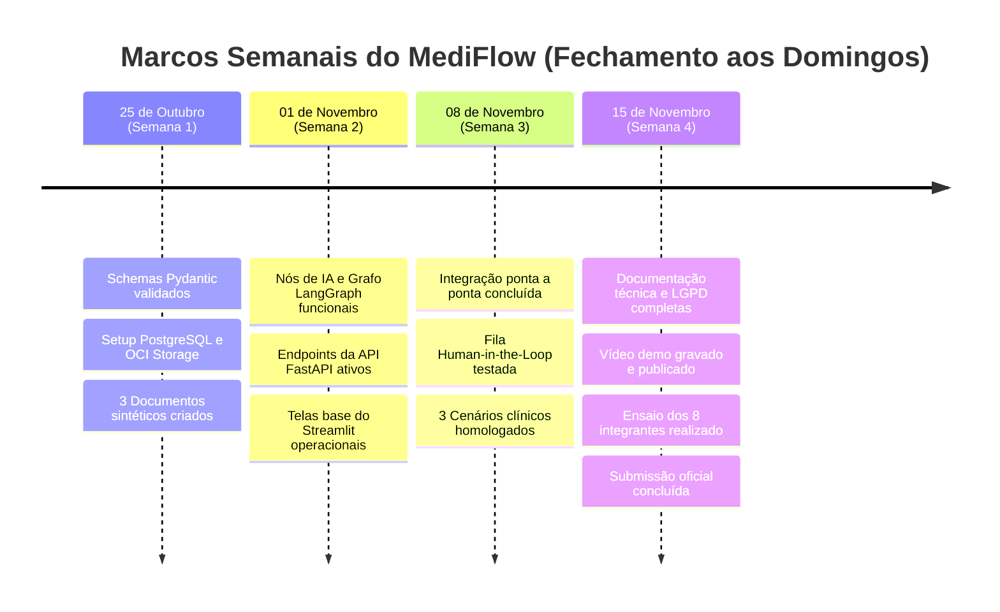

# 📅 MediFlow — Cronograma Diário Detalhado (Dia a Dia — 4 Semanas)

> **Período:** 20/10/2026 (Terça-feira) até 15/11/2026 (Domingo)  
> **Objetivo:** Guia operacional diário para cada uma das **4 Duplas Técnicas (8 Integrantes)** saberem com precisão o que executar a cada dia, sem bloqueios e com entregas contínuas.

---

## 👥 Legenda dos Grupos e Duplas de Trabalho

- ⚙️ **Grupo 1 — Core & Contratos:**
  - **P1:** Coordenação, Governança e Schemas Pydantic (`SCRUM-42` a `46`, `49` a `53`)
  - **P4:** Backend FastAPI e Orquestração HTTP (`SCRUM-65` a `67`, `69`, `99`)
- 🧠 **Grupo 2 — Inteligência Artificial:**
  - **P2:** Ingestão de Documentos, Prompts e Extração LLM (`SCRUM-47`, `56` a `58`, `64`, `96`)
  - **P3:** Grafo LangGraph, Cálculo de Score e Urgência Médica (`SCRUM-54`, `55`, `59` a `63`, `76`)
- ☁️ **Grupo 3 — Dados & Armazenamento:**
  - **P5:** OCI Object Storage Always Free e Roteamento de Arquivos (`SCRUM-48`, `70` a `75`, `94`)
  - **P6:** PostgreSQL, SQLAlchemy e Fila de Auditoria Humana (`SCRUM-68`, `77`, `79`, `97`, `98`)
- 🖥️ **Grupo 4 — Interface & Qualidade:**
  - **P7:** Frontend Streamlit (Triagem, Human-in-the-Loop e Histórico) (`SCRUM-78`, `100`, `93`)
  - **P8:** QA, Documentos Sintéticos e Testes Automatizados (`SCRUM-80` a `85`, `95`)

---

# 🚀 SEMANA 1 (20/10 a 25/10/2026): Fundação, Contratos & Amostras Clínicas

---

### 📌 Terça-feira, 20/10/2026 — Kickoff & Alinhamento Técnico
* **Meta do Dia:** Time alinhado, repositório clonado e ambientes locais funcionando.
* **Grupo 1 (Core & Contratos):**
  - **P1:** Conduzir preenchimento dos nomes na tabela do plano de ação (`SCRUM-42`). Validar branch `develop` como padrão de trabalho.
  - **P4:** Criar o esqueleto base de `backend/app/` (`main.py`, pasta `controllers/`, `services/`, `models/`, `schemas/`, `repositories/`, `agent/`).
* **Grupo 2 (IA):**
  - **P2:** Testar chamada à API da LLM com script simples (`SCRUM-47`).
  - **P3:** Analisar o PDF oficial (`mediflow (1).pdf`) e listar os nós necessários da máquina de estados (`SCRUM-54`).
* **Grupo 3 (Dados & Infra):**
  - **P5:** Acessar a console da Oracle Cloud (OCI) e confirmar tenancy Always Free ativa (`SCRUM-48`).
  - **P6:** Subir contêiner local do PostgreSQL 16 via Docker e testar conexão na porta 5432 (`SCRUM-97`).
* **Grupo 4 (UI & QA):**
  - **P7:** Criar app Streamlit mínimo (`frontend/app.py`) e testar execução local (`streamlit run app.py`).
  - **P8:** Definir estrutura dos 3 casos clínicos a serem criados (Rotina, TEP Agudo e Ambíguo) (`SCRUM-80`).
* **🤝 Sincronização do Dia:** Todo o time com ambiente Python 3.11+, Git e Docker prontos.

---

### 📌 Quarta-feira, 21/10/2026 — Contratos Pydantic & Amostras Iniciais
* **Meta do Dia:** Schemas JSON definidos (a fonte da verdade para backend, IA e frontend).
* **Grupo 1 (Core & Contratos):**
  - **P1:** Criar `backend/app/schemas/entrada.py` (`RequisicaoDocumento`) e `classificacao.py` (`ClassificacaoDocumento`) (`SCRUM-49`, `50`).
  - **P4:** Configurar `requirements.txt` do backend (`fastapi`, `uvicorn`, `pydantic`, `sqlalchemy`, `psycopg2-binary`, `python-multipart`).
* **Grupo 2 (IA):**
  - **P2:** Criar utilitário de leitura de texto puro e extração de PDF usando `pypdf` ou `pdfplumber` (`SCRUM-56`).
  - **P3:** Especificar as variáveis do estado clínico (`GraphState`) em `backend/app/agent/state.py` (`SCRUM-55`).
* **Grupo 3 (Dados & Infra):**
  - **P5:** Criar o bucket `mediflow-documentos-clinicos` no OCI com os prefixos `recebidos/`, `processados/` e `auditoria_humana/` (`SCRUM-70`).
  - **P6:** Criar arquivo de configuração de banco `backend/app/config/database.py` com `sessionmaker` do SQLAlchemy.
* **Grupo 4 (UI & QA):**
  - **P7:** Montar estrutura multipage do Streamlit: `pages/1_Triagem_Clinica.py`, `2_Auditoria_Humana.py`, `3_Historico.py`.
  - **P8:** Escrever o documento de **Rotina (Caso 1)**: Receita médica com CRM válido, paciente e posologia completa em `data/samples/rotina/` (`SCRUM-80`).
* **🤝 Sincronização do Dia:** P1 compartilha os modelos Pydantic com P2, P4 e P7.

---

### 📌 Quinta-feira, 22/10/2026 — Schemas de Extração & Caso de Urgência
* **Meta do Dia:** Contratos de extração de entidades médicas prontos e simulação do caso de urgência clínica.
* **Grupo 1 (Core & Contratos):**
  - **P1:** Criar schemas de entidades clínicas em `backend/app/schemas/extracao.py`: `DadosExtraidos`, `PacienteSchema`, `MedicoSchema`, `CIDSchema` (`SCRUM-51`).
  - **P4:** Criar endpoint `GET /health` e rotas vazias para documentação OpenAPI do FastAPI (`SCRUM-65`).
* **Grupo 2 (IA):**
  - **P2:** Escrever o prompt de classificação de tipos de documento (Receituário, Laudo, Guia TISS, Atestado) em `backend/app/agent/prompts/classificacao.py` (`SCRUM-64`).
  - **P3:** Definir regras formais para limiares de score (`score < 0.75` = Auditoria) e palavras-chave de urgência médica (`SCRUM-76`).
* **Grupo 3 (Dados & Infra):**
  - **P5:** Configurar autenticação do OCI SDK via variáveis de ambiente no `.env.example` (`SCRUM-71`).
  - **P6:** Mapear modelos ORM iniciais no SQLAlchemy: tabela `documentos` e tabela `triagens` (`SCRUM-97`).
* **Grupo 4 (UI & QA):**
  - **P7:** Implementar upload de arquivo no Streamlit (`st.file_uploader`) e layout de visualização em colunas.
  - **P8:** Escrever o documento de **Urgência (Caso 2)**: Laudo de Tomografia com Tromboembolismo Pulmonar Agudo (TEP) em `data/samples/urgencia/` (`SCRUM-80`).
* **🤝 Sincronização do Dia:** Dupla de IA (`P2+P3`) valida os schemas do P1 contra os textos do P8.

---

### 📌 Sexta-feira, 23/10/2026 — Validadores Clínicos & Caso Ambíguo
* **Meta do Dia:** Validadores determinísticos (CRM e CID) e os 3 arquivos sintéticos concluídos.
* **Grupo 1 (Core & Contratos):**
  - **P1:** Implementar validadores determinísticos: formato do CRM (`CRM/UF 123456`) e regex de CID-10 (`backend/app/schemas/validadores.py`) (`SCRUM-53`).
  - **P4:** Configurar `frontend/services/api_client.py` com métodos mockados para devolver respostas fictícias ao Streamlit.
* **Grupo 2 (IA):**
  - **P2:** Escrever prompt para extração estruturada de entidades com enforce de formato JSON compatível com o Pydantic (`SCRUM-58`).
  - **P3:** Montar o esqueleto do grafo com `StateGraph(GraphState)` em `backend/app/agent/graph.py` com nós vazios.
* **Grupo 3 (Dados & Infra):**
  - **P5:** Escrever módulo `backend/app/repositories/oci_storage.py` com tratamento de fallback para disco local quando não houver internet/chaves OCI (`SCRUM-74`).
  - **P6:** Criar script ou migration Alembic para criação automática das tabelas no PostgreSQL.
* **Grupo 4 (UI & QA):**
  - **P7:** Criar componentes visuais reutilizáveis do Streamlit: alertas coloridos de urgência (vermelho), rotina (verde) e atenção (amarelo) em `frontend/components/cards.py`.
  - **P8:** Escrever o documento de **Ambíguo (Caso 3)**: Documento rasurado ou com CRM faltante para forçar score baixo e revisão humana em `data/samples/ambiguo/` (`SCRUM-80`).
* **🤝 Sincronização do Dia:** P8 apresenta as 3 amostras sintéticas completas para o time.

---

### 📌 Sábado, 24/10/2026 — Integração dos Contratos com Mocks & Testes Iniciais
* **Meta do Dia:** Conectar os esquemas do backend com as telas do frontend usando dados mockados.
* **Grupo 1 & Grupo 4 (P1, P4, P7, P8):**
  - P4 e P7 conectam o Streamlit ao FastAPI rodando localmente, consumindo os schemas do P1.
  - P8 cria os primeiros testes unitários com Pytest para os validadores de CRM e CID (`SCRUM-84`).
* **Grupo 2 & Grupo 3 (P2, P3, P5, P6):**
  - P2 e P3 testam a chamada da LLM injetando os textos sintéticos do P8 e validando a resposta JSON.
  - P5 e P6 testam o upload de um arquivo para o bucket OCI e registro simulado no PostgreSQL.
* **🤝 Sincronização do Dia:** Validação cruzada entre as duplas.

---

### 📌 Domingo, 25/10/2026 — Fechamento da Semana 1 & Code Review Coletivo
* **Meta do Dia:** Todas as branches da Semana 1 mergeadas na `develop`, testes passando e zero pendências.
* **Atividades de Todos os Integrantes:**
  - [ ] Revisão mútua de Pull Requests nas duplas:
    - P1 revisa PR do P4 / P4 revisa PR do P1.
    - P2 revisa PR do P3 / P3 revisa PR do P2.
    - P5 revisa PR do P6 / P6 revisa PR do P5.
    - P7 revisa PR do P8 / P8 revisa PR do P7.
  - [ ] Excluir todas as branches mergeadas para manter o Git limpo.
  - [ ] Executar `pytest` para garantir 100% dos testes verdes.
* **🏁 Marco Atingido:** Fundação completa, schemas Pydantic prontos, banco de dados e OCI operacionais, 3 casos sintéticos criados.

---

# ⚙️ SEMANA 2 (26/10 a 01/11/2026): Construção dos Módulos Principais & IA

---

### 📌 Segunda-feira, 26/10/2026 — Nós de Classificação & Endpoints Base
* **Meta do Dia:** Nó de classificação funcional na IA e endpoint `POST /triagem` recebendo requisições.
* **Grupo 1 (Core & Contratos):**
  - **P1:** Apoiar P4 na criação dos contratos DTO de resposta final da triagem (`DecisaoRoteamento`).
  - **P4:** Implementar controller `POST /triagem` em `backend/app/controllers/triagem_controller.py` aceitando payload JSON (`SCRUM-66`).
* **Grupo 2 (IA):**
  - **P2:** Implementar a lógica do nó de classificação (`backend/app/agent/nodes/classificador.py`) consumindo a LLM (`SCRUM-57`).
  - **P3:** Criar nó de cálculo de score de confiança com penalização para campos ausentes (`SCRUM-59`).
* **Grupo 3 (Dados & Infra):**
  - **P5:** Implementar método de upload no repositório OCI salvando o arquivo original na pasta `recebidos/` (`SCRUM-72`).
  - **P6:** Implementar repositório `triagem_repository.py` com método de inserção de novo registro de triagem (`SCRUM-98`).
* **Grupo 4 (UI & QA):**
  - **P7:** Conectar a tela `1_Triagem_Clinica.py` ao endpoint do P4 para envio de texto e exibição do JSON retornado (`SCRUM-100`).
  - **P8:** Escrever testes unitários para o nó de classificação usando mocks de respostas da LLM.
* **🤝 Sincronização do Dia:** Primeiro teste de envio de texto no Streamlit gerando classificação no backend.

---

### 📌 Terça-feira, 27/10/2026 — Nó de Extração Estruturada & Upload Multipart
* **Meta do Dia:** Extração de paciente, CRM e hipótese diagnóstica + upload de arquivos PDF no backend.
* **Grupo 1 (Core & Contratos):**
  - **P1:** Adicionar checagens extras de consistência entre tipo de documento e entidades esperadas.
  - **P4:** Habilitar suporte a `multipart/form-data` no `POST /triagem` para receber PDFs e imagens (`SCRUM-67`).
* **Grupo 2 (IA):**
  - **P2:** Implementar nó de extração clínica estruturada (`backend/app/agent/nodes/extrator.py`) com retry em caso de JSON inválido (`SCRUM-58`).
  - **P3:** Criar nó de detecção de urgência médica com varredura de termos críticos (ex: "TEP", "parada", "choque") (`SCRUM-60`).
* **Grupo 3 (Dados & Infra):**
  - **P5:** Implementar função de geração de URL pré-autenticada ou leitura de bytes para exibição de documentos na UI.
  - **P6:** Adicionar campos de telemetria no PostgreSQL (tempo de processamento, tokens usados, score calculado).
* **Grupo 4 (UI & QA):**
  - **P7:** Ajustar tela de triagem no Streamlit para permitir arrastar e soltar arquivos PDF e exibir progresso com `st.spinner`.
  - **P8:** Testar extração do Caso 2 (TEP Agudo) e verificar se o nó de urgência marca a flag como `True`.
* **🤝 Sincronização do Dia:** O documento de TEP é extraído e o backend detecta a urgência médica com sucesso.

---

### 📌 Quarta-feira, 28/10/2026 — Arestas Condicionais do LangGraph & Fila de Auditoria
* **Meta do Dia:** Grafo de decisão roteando para os 3 destinos: Emergência, Auditoria e Fluxo Padrão.
* **Grupo 1 (Core & Contratos):**
  - **P1:** Definir schema de resposta da fila de auditoria (`ItemFilaAuditoria`) com os motivos da retenção.
  - **P4:** Iniciar a criação do endpoint `POST /auditoria/{id}/decisao` (`SCRUM-99`).
* **Grupo 2 (IA):**
  - **P2:** Realizar tuning de temperatura e system prompts para evitar alucinações na extração clínica.
  - **P3:** Implementar as arestas condicionais no LangGraph: se urgente → `Fila_Emergencia`; se score < 0.75 → `Auditoria_Humana`; senão → `Fluxo_Padrao` (`SCRUM-61`).
* **Grupo 3 (Dados & Infra):**
  - **P5:** Implementar rotação de arquivos no OCI: mover arquivo para `processados/urgentes/` ou `auditoria_humana/` (`SCRUM-73`).
  - **P6:** Criar endpoint `GET /auditoria` para listar documentos pendentes de revisão médica no PostgreSQL (`SCRUM-77`).
* **Grupo 4 (UI & QA):**
  - **P7:** Desenvolver esqueleto da tela `2_Auditoria_Humana.py` consumindo o `GET /auditoria` com tabela e cards de revisão (`SCRUM-78`).
  - **P8:** Escrever testes de integração para o grafo simulando os três caminhos condicionais.
* **🤝 Sincronização do Dia:** Grafo LangGraph compilado e executando os 3 fluxos de decisão.

---

### 📌 Quinta-feira, 29/10/2026 — Fallbacks Seguros & Painel Streamlit Human-in-the-Loop
* **Meta do Dia:** Sistema resiliente a falhas na LLM e interface médica de auditoria funcional.
* **Grupo 1 (Core & Contratos):**
  - **P1:** Validar campos editáveis que o médico pode alterar no painel de auditoria.
  - **P4:** Conectar o nó de contingência do LangGraph para nunca deixar uma requisição sem resposta (`SCRUM-62`).
* **Grupo 2 (IA):**
  - **P2:** Implementar fallback local via regex/regras caso a API da LLM retorne erro ou timeout.
  - **P3:** Implementar payload de notificação de urgência com mensagem formatada para o plantão médico (`SCRUM-63`).
* **Grupo 3 (Dados & Infra):**
  - **P5:** Monitorar uso de espaço no bucket OCI e certificar que permanece 100% dentro do free tier (`SCRUM-75`).
  - **P6:** Implementar tabela de trilha de auditoria (`auditoria_logs`) registrando ID do usuário, justificativa e valores anteriores (`SCRUM-79`).
* **Grupo 4 (UI & QA):**
  - **P7:** Adicionar botões no Streamlit: "Aprovar Documento", "Rejeitar" e campos de edição dos dados extraídos com baixa confiança (`SCRUM-78`).
  - **P8:** Testar se um payload corrompido é desviado com segurança para a auditoria humana.
* **🤝 Sincronização do Dia:** Ação de aprovação no Streamlit reflete no banco de dados.

---

### 📌 Sexta-feira, 30/10/2026 — Endpoint de Histórico & Polimento dos Repositórios
* **Meta do Dia:** Histórico de documentos consultável e repositórios desacoplados.
* **Grupo 1 (Core & Contratos):**
  - **P1:** Revisar tipagem de todos os schemas e eliminar qualquer tipo `Any` não documentado.
  - **P4:** Implementar rotas `GET /documentos` e `GET /documentos/{id}` com paginação e filtros (`SCRUM-68`).
* **Grupo 2 (IA):**
  - **P2 & P3:** Integrar nó de ingestão + nó classificador + extrator + urgência em um único fluxo contínuo e testar tempo de inferência.
* **Grupo 3 (Dados & Infra):**
  - **P5 & P6:** Garantir transacionalidade: se o upload falhar, o registro do banco não fica órfão.
* **Grupo 4 (UI & QA):**
  - **P7:** Criar tela `3_Historico.py` no Streamlit com filtros por status (Aprovado, Urgência, Em Auditoria).
  - **P8:** Bateria de testes unitários atingindo cobertura mínima de 80% nos serviços centrais (`SCRUM-84`).
* **🤝 Sincronização do Dia:** Fluxo completo rodando em ambiente local com banco e armazenamento.

---

### 📌 Sábado, 31/10/2026 — Testes de Integração Intermediários
* **Meta do Dia:** Testar o envio dos 3 documentos sintéticos ponta a ponta.
* **Atividades das Duplas:**
  - P2 e P4 executam o fluxo com o documento de rotina e verificam persistência no Postgres e OCI.
  - P3 e P7 testam o alerta de urgência médica na UI com o caso de TEP agudo.
  - P6 e P8 testam o caso ambíguo caindo na fila e sendo auditado no painel médico.
* **🤝 Sincronização do Dia:** Alinhamento de ajustes de bugs encontrados antes do fechamento.

---

### 📌 Domingo, 01/11/2026 — Fechamento da Semana 2 & Code Review Coletivo
* **Meta do Dia:** Merges concluídos, testes integrados passando e todos os módulos principais prontos.
* **Atividades de Todos os Integrantes:**
  - [ ] Revisão mútua de PRs entre parceiros de dupla.
  - [ ] Merge das branches na `develop` e exclusão imediata das branches concluídas.
  - [ ] Executar `pytest -v` e registrar resultados.
* **🏁 Marco Atingido:** Módulos de IA, Backend, Storage e Frontend 100% construídos e testados individualmente.

---

# 🔗 SEMANA 3 (02/11 a 08/11/2026): Integração E2E, Human-in-the-Loop & Validação dos 3 Cenários

---

### 📌 Segunda-feira, 02/11/2026 (Feriado/Planejado) — Acoplamento do LangGraph na FastAPI
* **Meta do Dia:** A API executa o grafo oficial do LangGraph a cada requisição de triagem.
* **Grupo 1 & Grupo 2 (P1, P2, P3, P4):**
  - Conectar o serviço `triagem_service.py` diretamente ao `graph.compile()`.
  - Passar o arquivo recebido na API para o nó de ingestão, aguardar a execução dos nós e devolver a resposta estruturada.
* **Grupo 3 & Grupo 4 (P5, P6, P7, P8):**
  - P5 e P6 asseguram sincronização de IDs entre o bucket OCI e o registro do PostgreSQL.
  - P7 e P8 testam o tempo de resposta e ajustam spinners e mensagens visuais no Streamlit.
* **🤝 Sincronização do Dia:** Primeira triagem clínica completa via Streamlit usando o grafo oficial do LangGraph.

---

### 📌 Terça-feira, 03/11/2026 — Homologação do Cenário 1: Rotina (Aprovação Automática)
* **Meta do Dia:** Cenário 1 (Rotina) homologado ponta a ponta sem intervenção humana.
* **Execução Conjunta (Todos):**
  - **P8:** Submeter amostra `01_rotina_receita_valida.pdf`.
  - **P2:** Conferir se o nó classificou corretamente como "Receituário" e extraiu médico, CRM e paciente.
  - **P3:** Validar score de confiança `>= 0.85` e flag de urgência como `False`.
  - **P4:** Confirmar retorno HTTP `200 OK` com `decisao: "APROVADO_AUTOMATICO"`.
  - **P5:** Confirmar arquivo movido para `processados/rotina/` no OCI.
  - **P6:** Confirmar gravação no Postgres com status `APROVADO`.
  - **P7:** Confirmar badge verde de sucesso na tela do Streamlit.
* **✅ Marco Registrado:** `SCRUM-81` (Cenário 1) validado e homologado com prints e logs salvos.

---

### 📌 Quarta-feira, 04/11/2026 — Homologação do Cenário 2: Urgência Médica (TEP Agudo)
* **Meta do Dia:** Cenário 2 (Urgência) disparando alerta imediato e fila de emergência.
* **Execução Conjunta (Todos):**
  - **P8:** Submeter amostra `02_urgencia_tep_agudo.pdf` (Tomografia com Tromboembolismo Pulmonar Agudo).
  - **P2 & P3:** Validar detecção de achado crítico no laudo e ativação da flag `urgencia_medica: True`.
  - **P3:** Roteamento imediato para `Fila_Emergencia_Medica` e montagem do payload `Alerta_Plantao_Medico`.
  - **P5:** Confirmar arquivamento na pasta `processados/urgentes/` do bucket.
  - **P6:** Confirmar persistência no Postgres com prioridade máxima.
  - **P7:** Validar alerta vermelho pulsante na tela do Streamlit com orientações imediatas para a equipe médica.
* **✅ Marco Registrado:** `SCRUM-82` (Cenário 2) validado e homologado.

---

### 📌 Quinta-feira, 05/11/2026 — Homologação do Cenário 3: Ambíguo & Auditoria Humana
* **Meta do Dia:** Cenário 3 (Ambíguo) retido na fila e retificado com sucesso pelo médico no Streamlit.
* **Execução Conjunta (Todos):**
  - **P8:** Submeter amostra `03_ambiguo_dados_ausentes.pdf` (documento sem CRM legível).
  - **P3:** Validar score de confiança `< 0.75` e roteamento obrigatório para `Auditoria_Humana`.
  - **P5 & P6:** Confirmar armazenamento em `auditoria_humana/` no OCI e listagem na tabela de auditoria.
  - **P7:** Médico visualiza o documento na tela `2_Auditoria_Humana.py`, confere os campos com aviso de baixa confiança, insere o CRM corrigido e clica em **"Aprovar com Retificação"**.
  - **P4:** Chamada bem-sucedida ao `POST /auditoria/{id}/decisao` com as alterações.
  - **P6:** Trilha de auditoria registrada: data, hora, alteração do CRM e justificativa clínica.
* **✅ Marco Registrado:** `SCRUM-83` (Cenário 3) validado e homologado.

---

### 📌 Sexta-feira, 06/11/2026 — Testes Automatizados E2E & Implementação de Diferenciais
* **Meta do Dia:** Bateria de testes de ponta a ponta automatizada e implementação de diferenciais de destaque.
* **Grupo 1 & Grupo 4 (P1, P4, P7, P8):**
  - **P8:** Escrever suite de testes E2E com Pytest executando os 3 cenários em sequência (`SCRUM-85`).
  - **P7:** *(Diferencial)* Adicionar aba de configuração de regras e limiares de triagem para o gestor hospitalar (`SCRUM-93`).
* **Grupo 2 & Grupo 3 (P2, P3, P5, P6):**
  - **P2:** *(Diferencial)* Implementar suporte a OCR para receitas manuscritas (`SCRUM-96`).
  - **P5:** *(Diferencial)* Validar deploy em VM OCI Compute Always Free ou empacotar `docker-compose.yml` (`SCRUM-94`).
  - **P8:** *(Diferencial)* Configurar workflow n8n para disparo de webhook de alerta em tempo real (`SCRUM-95`).
* **🤝 Sincronização do Dia:** Suíte de testes ponta a ponta 100% verde no CI/terminal.

---

### 📌 Sábado, 07/11/2026 — Testes de Estresse, Tratamento de Exceções & Refino
* **Meta do Dia:** Garantir que o sistema não quebre sob entradas inesperadas ou instabilidades.
* **Atividades de Todos os Integrantes:**
  - Testar envio de arquivos corrompidos, arquivos muito grandes e sem texto legível.
  - Conferir se todas as telas exibem mensagens de erro amigáveis ao invés de traces de stack.
  - Revisar design responsivo e acessibilidade dos componentes no Streamlit.
* **🤝 Sincronização do Dia:** Congelamento formal de código (Code Freeze). Nenhuma nova funcionalidade a partir daqui.

---

### 📌 Domingo, 08/11/2026 — Fechamento da Semana 3 & Homologação Geral do MVP
* **Meta do Dia:** MVP 100% integrado, estável e testado.
* **Atividades de Todos os Integrantes:**
  - [ ] Merges finais da integração na branch `develop`.
  - [ ] Bateria completa de testes Pytest executada com sucesso.
  - [ ] Exclusão de branches antigas.
* **🏁 Marco Atingido:** O MediFlow está completo, cobrindo com precisão Rotina, Urgência e Auditoria Humana.

---

# 🎓 SEMANA 4 (09/11 a 15/11/2026): Homologação Final, Documentação, Vídeo & Apresentação

---

### 📌 Segunda-feira, 09/11/2026 — Estruturação da Documentação Oficial (README & Arquitetura)
* **Meta do Dia:** Início da redação colaborativa da documentação técnica no `README.md`.
* **Divisão de Seções:**
  - **P1 & P4:** Redigir seção de Visão Geral, Arquitetura Monorepo 100% Python e instruções de execução da API (`SCRUM-86`).
  - **P2 & P3:** Gerar e exportar o diagrama oficial da máquina de estados do LangGraph em formato Mermaid (`SCRUM-87`).
  - **P5:** Redigir guia de configuração e variáveis do OCI Object Storage Always Free.
  - **P6:** Documentar schema do banco de dados relacional e queries da trilha de auditoria.
  - **P7:** Documentar telas e capturar screenshots da interface Streamlit.
  - **P8:** Documentar casos de teste sintéticos e comandos do Pytest.
* **🤝 Sincronização do Dia:** Rascunho completo do README unificado.

---

### 📌 Terça-feira, 10/11/2026 — Contratos de API & Exemplos de JSON
* **Meta do Dia:** Documentação impecável das requisições e respostas da API REST.
* **Grupo 1 & Grupo 2:**
  - **P1 & P4:** Detalhar no README todos os endpoints (`POST /triagem`, `POST /auditoria/{id}/decisao`, `GET /documentos`, `GET /auditoria`), acompanhados dos JSONs reais de entrada e saída dos 3 cenários clínicos (`SCRUM-88`).
* **Grupo 3 & Grupo 4:**
  - **P6 & P8:** Iniciar redação da seção de **Conformidade LGPD, Riscos Clínicos e Limitações** (`SCRUM-89`):
    - Uso exclusivo de dados sintéticos sem exposição de dados pessoais reais.
    - Princípio de que o agente atua como suporte à decisão médica e jamais substitui o diagnóstico profissional.
    - Trilha de auditoria imutável para conformidade legal.
* **🤝 Sincronização do Dia:** Seções de contratos e conformidade jurídica/clínica finalizadas.

---

### 📌 Quarta-feira, 11/11/2026 — Roteiro Detalhado do Vídeo e Pitch
* **Meta do Dia:** Roteiro de gravação do vídeo demo e falas dos 8 integrantes estruturadas.
* **Atividades de Todos os Integrantes:**
  - **P7 & P8:** Elaborar roteiro de gravação do vídeo (tempo alvo: ~5 a 7 minutos).
  - **P1 a P8:** Cada integrante escreve e revisa o resumo de 1,5 minuto sobre a sua frente para a apresentação ao vivo (`SCRUM-91`):
    - **P1:** Dor de negócio e contratos de dados.
    - **P2:** Ingestão multimodal e prompts.
    - **P3:** Grafo LangGraph, score de confiança e urgência.
    - **P4:** Backend FastAPI e resiliência.
    - **P5:** OCI Object Storage Always Free.
    - **P6:** PostgreSQL e rastreabilidade da auditoria.
    - **P7:** Demonstração ao vivo no Streamlit (Rotina e Urgência).
    - **P8:** Demonstração ao vivo no Streamlit (Ambíguo na Auditoria) e qualidade/testes.
* **🤝 Sincronização do Dia:** Roteiro aprovado por todos os 8 membros.

---

### 📌 Quinta-feira, 12/11/2026 — Gravação do Vídeo de Demonstração
* **Meta do Dia:** Vídeo de demonstração gravado, editado e hospedado.
* **Atividades:**
  - **P7 & P8:** Conduzir a gravação na interface do Streamlit (`SCRUM-90`):
    - Take 1: Apresentação da interface e tela inicial.
    - Take 2: Envio do Caso 1 (Rotina) → aprovação automática em segundos.
    - Take 3: Envio do Caso 2 (TEP Agudo) → detecção de urgência, alerta visual vermelho e direcionamento para fila de emergência.
    - Take 4: Envio do Caso 3 (Ambíguo) → retenção na fila de auditoria humana, médico corrigindo dados e aprovando.
  - Subir vídeo no YouTube (Não Listado) ou Google Drive compartilhado e incluir link no README.
* **🤝 Sincronização do Dia:** Link do vídeo testado e funcionando publicamente.

---

### 📌 Sexta-feira, 13/11/2026 — Checklist Final contra o PDF do Desafio
* **Meta do Dia:** Auditoria rigorosa de todos os requisitos do edital (`mediflow (1).pdf`).
* **Execução Coletiva (`SCRUM-92`):**
  - [ ] Multi-documento (receita, laudo, atestado, guias)? **Sim.**
  - [ ] Multimodal (PDF, texto, imagem)? **Sim.**
  - [ ] Extração de entidades (médico, CRM, CID, paciente)? **Sim.**
  - [ ] Score de confiança calculado? **Sim.**
  - [ ] Detecção de urgência com alerta? **Sim.**
  - [ ] Fila Human-in-the-Loop implementada? **Sim.**
  - [ ] Storage na OCI com buckets organizados? **Sim.**
  - [ ] Stack 100% Python e arquitetura desacoplada? **Sim.**
  - [ ] Testes automatizados passando? **Sim.**
  - [ ] README e seção de LGPD completos? **Sim.**
* **🤝 Sincronização do Dia:** Nenhum item do regulamento pendente.

---

### 📌 Sábado, 14/11/2026 — Ensaio Geral Cronometrado da Apresentação
* **Meta do Dia:** Todos os 8 integrantes ensaiados com cronômetro na mão e transições fluidas.
* **Horário:** Sessão de 1 hora com o time reunido em call.
* **Atividades:**
  - **1º Ensaio Geral:** Passagem completa das 8 falas cronometrando exatamente 1m30s por pessoa.
  - **Ajustes:** Cortar redundâncias e afinar transições de tela entre P6, P7 e P8.
  - **2º Ensaio Geral:** Execução limpa simulando o dia oficial da banca/pitch.
* **🤝 Sincronização do Dia:** Time seguro, alinhado e pronto para a entrega.

---

### 📌 Domingo, 15/11/2026 — Submissão Oficial do Projeto MediFlow 🎉
* **Meta do Dia:** Pull Request final da `develop` para a `main`, release tag criada e entrega submetida.
* **Checklist de Entrega:**
  - [ ] PR da `develop` para a `main` revisado e mergeado.
  - [ ] Tag `v1.0.0-mvp` criada no GitHub.
  - [ ] Nenhum arquivo `.env` ou segredo versionado no repositório.
  - [ ] Links do README, vídeo demo e repositório testados.
  - [ ] Submissão do formulário oficial do Hackathon / No-Country.
* **🏆 Projeto Concluído com Sucesso!**

---

## 📋 Resumo das Entregas por Domingo

