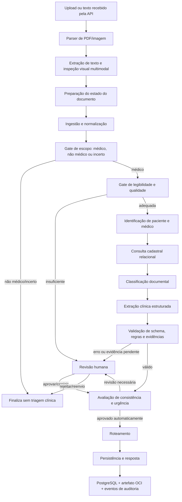

# Arquitetura da IA de triagem clínica

## O que significa “IA” neste projeto

O MediFlow não treina nem hospeda um modelo próprio. O backend executa um pipeline híbrido: chama um modelo externo de linguagem configurado via OpenRouter para ler/classificar conteúdo, aplica regras determinísticas e validadores no próprio código e pausa para revisão humana quando os critérios de segurança não são atendidos.

O texto e a imagem do documento são dados não confiáveis. Os prompts orientam o modelo a ignorar instruções dentro do documento, não inventar campos e citar somente evidência observável.

## Visão do fluxo

## Etapas da IA

### 1. Leitura e preparação do documento

O `DocumentParserService` aceita PDFs e imagens. PDFs podem fornecer texto nativo; páginas escaneadas ou com conteúdo visual são renderizadas para inspeção multimodal. Imagens são encaminhadas para leitura/transcrição com o cliente LLM. A inspeção também pode gerar campos administrativos rotulados e metadados.

Essa leitura produz texto para o pipeline; ela não prova, por si só, que todo trecho de OCR está correto. O validador mantém a distinção entre original disponível, OCR produzido e confirmação visual. Conteúdo visual ainda pendente de conferência pode ir para revisão humana.

### 2. Gate de escopo e legibilidade

O harness decide, com evidências, se o documento é médico, não médico ou incerto e avalia legibilidade. Evidências textuais são verificadas contra o texto recebido; evidência visual precisa descrever elementos realmente observáveis. Se o escopo não puder ser sustentado, a triagem clínica não segue adiante.

### 3. Qualidade do documento

O nó de qualidade verifica se há texto suficiente, marcadores de OCR sem conteúdo confiável, legibilidade declarada e vínculo com a fonte original. Se a qualidade não atende aos critérios, o grafo pausa para avaliação humana.

### 4. Identificação e consulta cadastral

O nó de identificação pede à LLM os dados explícitos de paciente e médico, sem inferir nem completar valores. O serviço pode procurar cadastros existentes por identificadores; esse resultado serve como contexto de identificação, não como evidência para inventar diagnóstico ou conteúdo do documento.

### 5. Classificação documental

A LLM classifica o tipo documental (`RECEITA`, `LAUDO`, `GUIA_TISS`, `RELATORIO_ALTA` ou `ATESTADO`), a especialidade, a prioridade e um score de confiança. A resposta JSON é validada pelo schema Pydantic.

### 6. Extração clínica

A LLM extrai campos explícitos como paciente, CPF, médico/CRM, exame, diagnóstico, medicamentos e CID. Em laudos laboratoriais, o prompt orienta comparar números com referências que constem no próprio documento e descrever o achado objetivo sem inferir doença. CID só é extraído quando o código está escrito.

Para imagens, se o CPF não passar na validação, existe uma releitura visual específica, limitada a dez tentativas. Os dígitos são mantidos como texto e validados; se não houver leitura válida, o caso é direcionado para revisão.

### 7. Validação determinística e evidências

O nó validador valida estrutura dos dados, regras por tipo de documento, formatos de CRM/CID, plausibilidade de idade e correspondência dos valores com trechos textuais. Campos sem suporte são bloqueados. A existência de um arquivo de imagem/PDF não é tratada como confirmação automática do OCR.

### 8. Avaliação de risco, revisão e roteamento

O avaliador aplica regras determinísticas de consistência e procura termos críticos configurados no código. O score sofre penalidades por inconsistências e é comparado ao limiar de confiança. Achado urgente, inconsistência ou confiança baixa encaminha para revisão humana.

Quando aplicável, o grafo pausa com checkpoint. A auditoria humana pode aprovar, corrigir, rejeitar ou solicitar reenvio; a decisão retoma o mesmo thread do documento. Após revisão válida, o roteador escolhe a fila conforme urgência, tipo documental e necessidade de auditoria.

## Modelo de linguagem e configuração

- Adaptador: `backend/app/agent/llm.py` (LangChain `ChatOpenAI` apontando para a API OpenRouter).
- Modelo: variável `OPENROUTER_MODEL`.
- Credenciais: `OPENROUTER_API_KEY` e, opcionalmente, `OPENROUTER_API_KEY_2`.
- Contingência explícita atual: alternância de chaves quando detectado rate limit/quota HTTP 429. Outras falhas são devolvidas como indisponibilidade do serviço de IA; não há fallback automático para outro provedor/modelo neste adaptador.
- Prompts: `backend/app/agent/prompts/`.
- Estado de execução: `backend/app/agent/state.py` (`GraphState`).

## Execução assíncrona e persistência

1. A API valida e salva o arquivo original no armazenamento configurado, registra o trabalho na fila RQ do Redis e informa o identificador do documento.
2. Um processo worker consome o job, lê ou extrai texto do arquivo e executa o serviço de triagem.
3. O LangGraph usa `documento_id` como `thread_id`; o checkpointer PostgreSQL conserva estados para consultar progresso e retomar revisão humana.
4. O resultado corrente da triagem e as relações com paciente/médico/hospital são persistidos no PostgreSQL. O resultado JSON também pode ser salvo como artefato no OCI; eventos de auditoria são enviados ao MongoDB e eventos de progresso ao Redis/SSE.

Redis é fila/eventos, não a fonte clínica permanente. O modelo relacional e a trilha de auditoria estão documentados separadamente em [Bancos e normalização](ARQUITETURA_DOS_BANCOS_E_NORMALIZACAO.md). Os problemas de enqueue, disponibilidade e consistência entre armazenamento e auditoria estão em [Pendências e propostas](ARQUITETURA_DADOS_PENDENCIAS_E_PROPOSTAS.md).

## Mapa dos módulos

| Responsabilidade | Código |
|---|---|
| Construção, roteamento condicional e retomada do grafo | `backend/app/agent/graph.py` |
| Estado compartilhado dos nós | `backend/app/agent/state.py` |
| Cliente LLM e rotação de chaves | `backend/app/agent/llm.py` |
| Gate de escopo, citações e proteção contra instruções no documento | `backend/app/agent/harness.py`, `backend/app/agent/prompts/escopo.py` |
| Identificação/classificação/extração/validação/avaliação/roteamento | `backend/app/agent/nodes/` |
| Templates de classificação e extração | `backend/app/agent/prompts/` |
| Leitura e inspeção de PDFs/imagens | `backend/app/services/document_parser.py` |
| Metadados pré-triagem | `backend/app/services/metadados_inspecao.py` |
| Consumo dos jobs assíncronos | `backend/app/queue_worker.py`, `backend/app/services/triagem_worker.py` |

## Limites da descrição

Este documento descreve o código versionado. Não atesta precisão clínica, disponibilidade do provedor LLM ou execução atual dos containers. A classificação e extração são assistivas; validação determinística e revisão humana continuam sendo os controles do fluxo.
