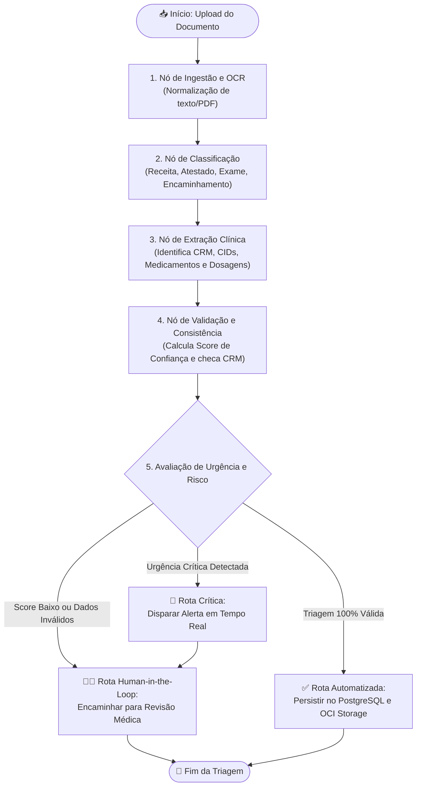

# 🧠 Guia Completo: Grafos de IA com LangGraph

Este documento serve como referência de aprendizado e alinhamento conceitual para a equipe sobre o uso de **Grafos Computacionais de Decisão (LangGraph)** no projeto **G10-BRASIL-05**.

---

## 1. O que é um "Grafo" neste projeto?

Muitas pessoas associam a palavra *grafo* ao recurso **Graph View do Obsidian** (uma teia estática que conecta anotações). **Aqui o significado é completamente diferente:**

| Característica | Obsidian Graph | LangGraph (Nosso Projeto) |
| :--- | :--- | :--- |
| **Tipo** | Grafo de Conhecimento estático (*Knowledge Graph*) | Máquina de Estados / Fluxo de Execução dinâmico |
| **Finalidade** | Visualizar links entre notas de texto | Controlar o raciocínio e a tomada de decisão da IA |
| **Comportamento** | Passivo (apenas exibe dados interligados) | Ativo (executa código, chama LLMs, bifurca caminhos) |
| **Analogia** | Um mapa mental | Uma **linha de montagem industrial inteligente** |

No LangGraph, um grafo é um **orquestrador de fluxo** onde funções especializadas (Nós) recebem dados, tomam decisões e passam o bastão para o próximo passo através de caminhos controlados (Arestas).

---

## 2. Os Três Pilares do LangGraph

```text
┌────────────────────────────────────────────────────────┐
│                      GraphState                        │
│          (A "Prancheta do Paciente" compartilhada)     │
└────────────────────────────────────────────────────────┘
        │                                ▲
        ▼                                │
   [ Nó 1: Lê ] ───(Aresta)───► [ Nó 2: Atualiza ] ───► [ Nó 3: Decisão ]
```

### 1. Nós (*Nodes*)
- Cada nó é uma **função Python pura** com uma única responsabilidade (**SRP - Single Responsibility Principle**).
- Um nó nunca tenta resolver todo o problema médico de uma vez:
  - O nó classificador **apenas** diz se é receita, exame ou atestado.
  - O nó de extração **apenas** extrai entidades (CRM, CID, medicamentos).
  - O nó validador **apenas** confere se o CRM existe e se a dosagem é aceitável.

### 2. Estado (*GraphState*)
- É o objeto central (tipado com **Pydantic v2**) que trafega por todos os nós.
- Funciona como a **prancheta médica do paciente**: cada especialista lê o que o médico anterior escreveu e preenche os seus próprios campos.
- Nenhum nó precisa se comunicar diretamente com outro nó; todos leem e escrevem no `GraphState`.

### 3. Arestas e Arestas Condicionais (*Edges & Conditional Edges*)
- **Arestas Normais (`add_edge`):** Conexão direta e previsível (após o Nó A, vá sempre para o Nó B).
- **Arestas Condicionais (`add_conditional_edges`):** São as **bifurcações** da lógica:
  - *"Se o score de confiança da IA for menor que 75%, desvie para a Fila de Auditoria Humana."*
  - *"Se for detectada urgência médica (ex: risco cardíaco), dispare um alerta imediato."*
  - *"Se estiver tudo correto, envie para o banco de dados e OCI Storage."*

---

## 3. O Grafo de Triagem Clínica do Projeto

Abaixo está o diagrama do fluxo planejado para o agente de triagem do **G10-BRASIL-05**:



---

## 4. Por que usar Grafos em vez de um Prompt Único?

Se enviarmos um documento clínico inteiro para o ChatGPT em um único prompt pedindo *"Classifique, extraia o CRM, confira os remédios, veja se é urgente e salve"*, ocorrem problemas graves:
1. **Alucinações Frequentes:** LLMs se perdem em tarefas com múltiplas instruções concorrentes.
2. **Impossibilidade de Validação Intermediária:** Não dá para checar se o CRM é verdadeiro antes de a IA inventar uma dosagem.
3. **Falta de Explicabilidade:** Se a resposta estiver errada, você não sabe em qual etapa o raciocínio falhou.
4. **Sem Controle de Custos:** Você gastaria tokens caros chamando o modelo maior para tarefas triviais de formatação.

Com o **LangGraph**:
- Cada etapa tem seu próprio prompt pequeno, calibrado e testável.
- Código Python determinístico roda entre um nó e outro para validar regras médicas antes do próximo passo da IA.
- Se houver falha, apenas o nó que falhou é reexecutado ou desvia para intervenção humana.

---

## 5. Exemplo Prático em Python (Esqueleto Mínimo)

```python
from typing import TypedDict, Optional
from langgraph.graph import StateGraph, END

# 1. Definir o Estado Compartilhado
class TriagemState(TypedDict):
    texto_documento: str
    tipo_documento: Optional[str]
    crm_medico: Optional[str]
    score_confianca: float
    urgente: bool
    necessita_revisao: bool

# 2. Definir os Nós (Funções Puras)
def classificar_documento(state: TriagemState) -> dict:
    # Simulação da chamada de LLM para classificação
    texto = state["texto_documento"].lower()
    tipo = "Receita" if "receita" in texto or "mg" in texto else "Outro"
    return {"tipo_documento": tipo}

def extrair_entidades(state: TriagemState) -> dict:
    # Simulação de extração de CRM e cálculo de score
    return {
        "crm_medico": "123456/SP",
        "score_confianca": 0.88,
        "urgente": False
    }

def avaliar_roteamento(state: TriagemState) -> str:
    # Aresta condicional decidindo o próximo passo
    if state["score_confianca"] < 0.70:
        return "auditoria_humana"
    return "concluido"

# 3. Construir o Grafo
workflow = StateGraph(TriagemState)

workflow.add_node("classificador", classificar_documento)
workflow.add_node("extrator", extrair_entidades)

workflow.set_entry_point("classificador")
workflow.add_edge("classificador", "extrator")

workflow.add_conditional_edges(
    "extrator",
    avaliar_roteamento,
    {
        "auditoria_humana": END,
        "concluido": END
    }
)

# 4. Compilar o Grafo
app = workflow.compile()
```

---

## 6. Glossário Rápido para a Equipe

- **StateGraph:** A classe principal do LangGraph que gerencia a máquina de estados.
- **Node (Nó):** Função executora de um passo específico.
- **Edge (Aresta):** Linha que conecta nós sequenciais.
- **Conditional Edge (Aresta Condicional):** Decisão dinâmica baseada em valores do estado.
- **Human-in-the-Loop:** Ponto de parada no grafo onde a execução aguarda uma validação ou correção feita por um humano no painel web antes de prosseguir.
