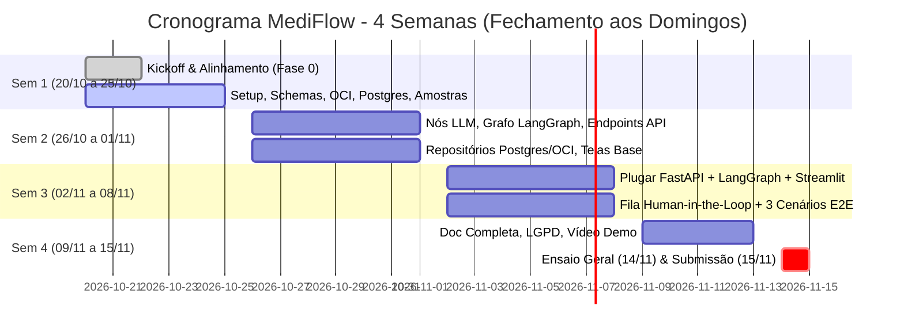

# 🏥 MediFlow — Plano de Ação de 4 Semanas (Equipe G10-BRASIL-05)

> **Período de Execução:** 20/10/2026 a 15/11/2026 (4 Semanas com ciclos encerrando sempre aos Domingos)  
> **Objetivo:** Entregar o MVP 100% funcional do **MediFlow** (stack **100% Python**: Streamlit + FastAPI + LangGraph + PostgreSQL + OCI Object Storage) cobrindo com excelência os **3 cenários obrigatórios de demo**:
> 1. ✅ **Rotina** (fluxo padrão aprovado automaticamente)
> 2. 🚨 **Urgência Médica** (ex.: TEP agudo → fila de emergência + alerta de plantão)
> 3. 👨‍⚕️ **Ambíguo / Baixa Confiança** (encaminhado para revisão médica no painel Human-in-the-Loop)
>
> **Regra nº 1:** Ninguém trabalha isolado. **Todos os 8 integrantes programam**, atuam em **duplas de apoio**, documentam e **apresentam sua respectiva frente** na entrega final.

---

## 📌 1. Informações Gerais e Marcos do Projeto (Ciclos até Domingo)

| Campo | Valor / Data |
| :--- | :--- |
| **Data de Início** | **20/10/2026** (Hoje — Terça-feira) |
| **Fim da Semana 1 (Fundação)** | **25/10/2026** (Domingo) |
| **Fim da Semana 2 (Construção dos Módulos)** | **01/11/2026** (Domingo) |
| **Fim da Semana 3 (Integração & Cenários E2E)** | **08/11/2026** (Domingo) |
| **Ensaio Geral da Apresentação** | **14/11/2026** (Sábado) |
| **Data de Entrega Final e Submissão** | **15/11/2026** (Domingo) *(com tolerância até 16/11 caso bancas ocorram na segunda)* |
| **Horário Sugerido da Daily (15 min)** | A definir com o time (ex.: 09:30 ou 19:30) |
| **Canal de Comunicação** | Discord / WhatsApp / Slack |
| **Quadro Jira (`SCRUM`)** | `https://no-country.atlassian.net` |
| **Repositório GitHub** | `https://github.com/No-Country-simulation/G10-BRASIL-05` |
| **Stack Oficial (ADR 0004)** | **Streamlit + FastAPI + LangGraph + PostgreSQL + OCI Always Free** |
| **LLM Padrão** | Gemini 1.5 Pro / Flash (ou OpenAI/Claude conforme disponibilidade de chaves) |
| **Limiar de Confiança p/ Revisão Humana** | `< 0.75` (Score inferior a 75% encaminha para auditoria médica) |

---

## 👥 2. Matriz das 8 Frentes e Duplas Técnicas

Cada pessoa é **responsável principal** por uma frente, possui um **parceiro fixo** para code review, destravamento rápido e testes integrados, e apresenta seu bloco na banca final:

| # | Frente Técnica (Mão na Massa) | Responsável | Parceiro (Ajuda e Revisa) | Cards Jira | Foco na Apresentação (`SCRUM-91`) |
| :-: | :--- | :--- | :-: | :--- | :--- |
| **P1** | 🧭 **Setup, Contratos & Schemas Pydantic** | *(A preencher)* | P4 | `SCRUM-42` a `46`, `49` a `53` | Problema clínico, arquitetura e contratos JSON/validadores |
| **P2** | 🤖 **IA: Ingestão, Classificação & Prompts** | *(A preencher)* | P3 | `SCRUM-47`, `56`, `57`, `58`, `64`, `96` | Leitura multimodal (PDF/img/txt), prompts e extração clínica |
| **P3** | 🔀 **IA: Grafo LangGraph, Score & Urgência** | *(A preencher)* | P2 | `SCRUM-54`, `55`, `59` a `63`, `76` | Máquina de estados, score de confiança e alerta de TEP/urgência |
| **P4** | ⚙️ **Backend API (FastAPI & Orquestração)** | *(A preencher)* | P1 | `SCRUM-65`, `66`, `67`, `69`, `99` | Endpoints REST (`POST /triagem`, `/auditoria/{id}/decisao`) |
| **P5** | ☁️ **Infra & Nuvem (OCI Object Storage)** | *(A preencher)* | P6 | `SCRUM-48`, `70` a `75`, `94` | Buckets OCI Always Free e segregação por status |
| **P6** | 🗄️ **Banco de Dados & Auditoria (PostgreSQL)** | *(A preencher)* | P5 | `SCRUM-68`, `77`, `79`, `97`, `98` | Modelagem Postgres, histórico e trilha de auditoria médica |
| **P7** | 🖥️ **Frontend (Streamlit: Telas & Auditoria)** | *(A preencher)* | P8 | `SCRUM-78`, `100`, `93` | Telas de Upload/Triagem e Painel Human-in-the-Loop |
| **P8** | 🧪 **QA, Amostras Clínicas & Testes Pytest** | *(A preencher)* | P7 | `SCRUM-80` a `85`, `95` | Bateria de testes e demo dos 3 cenários clínicos |
| **TODOS** | 🎤 **Documentação, Vídeo e Pitch Final** | **Time Todo** | Time Todo | `SCRUM-86` a `92` | 1,5 min de fala individual na demo oficial |

### 🤝 As 4 Duplas de Apoio
1. **Dupla 1 — Core & Contratos (`P1 + P4`):** Schemas Pydantic + Endpoints FastAPI
2. **Dupla 2 — Inteligência Artificial (`P2 + P3`):** Ingestão/Prompts + Grafo LangGraph
3. **Dupla 3 — Dados & Armazenamento (`P5 + P6`):** OCI Object Storage + PostgreSQL
4. **Dupla 4 — Interface & Qualidade (`P7 + P8`):** Streamlit + QA/Cenários Clínicos

---

## 📅 3. Cronograma Detalhado — 4 Semanas (Ciclos com Fechamento aos Domingos)

---

### 📍 SEMANA 1 (20/10/2026 a 25/10/2026 — Terça a Domingo): Fundação, Contratos & Amostras Clínicas

> **Meta da Semana (até Domingo 25/10):** Deixar toda a base pronta e acordada. Ao final do domingo, ninguém fica bloqueado por falta de contratos, banco ou exemplos de teste.

#### Atividades por Integrante:
- **P1 (Setup & Schemas):**
  - [ ] `SCRUM-42` — Preencher responsáveis e papéis no plano.
  - [ ] `SCRUM-43` e `SCRUM-44` — Confirmar estrutura de pastas (`backend/`, `frontend/`, `data/samples/`).
  - [ ] `SCRUM-45` e `SCRUM-46` — Configurar `requirements.txt` inicial e `.env.example`.
  - [ ] `SCRUM-49` a `SCRUM-52` — Implementar todos os schemas Pydantic v2 em `backend/app/schemas/` (`RequisicaoDocumento`, `ClassificacaoDocumento`, `DadosExtraidos`, `DecisaoRoteamento`).
  - [ ] `SCRUM-53` — Implementar validadores determinísticos de formato de CRM e CID-10.
- **P2 (IA Ingestão & Prompts):**
  - [ ] `SCRUM-47` — Testar chave de API da LLM em `backend/app/agent/config.py`.
  - [ ] `SCRUM-56` — Criar utilitário/nó de ingestão inicial (extração de texto de PDF e texto puro).
  - [ ] `SCRUM-64` — Versionar primeiros templates de prompts de classificação e extração.
- **P3 (LangGraph & Urgência):**
  - [ ] `SCRUM-54` — Desenhar diagrama da máquina de estados do LangGraph.
  - [ ] `SCRUM-55` — Implementar classe tipada `GraphState` em `backend/app/agent/state.py`.
  - [ ] `SCRUM-76` — Documentar regras e limiar de corte de confiança (`< 0.75`).
- **P4 (FastAPI Base):**
  - [ ] `SCRUM-65` — Estruturar app FastAPI, middleware de CORS e rota `GET /health`.
  - [ ] `SCRUM-69` — Configurar tratamento global de exceções e respostas de erro padronizadas.
- **P5 (OCI Object Storage):**
  - [ ] `SCRUM-48` e `SCRUM-70` — Criar bucket `mediflow-documentos-clinicos` e estrutura de prefixos.
  - [ ] `SCRUM-71` e `SCRUM-74` — Configurar SDK OCI e criar modo fallback local para rodar sem credenciais na máquina de quem não tem chave OCI.
- **P6 (PostgreSQL & Modelos):**
  - [ ] `SCRUM-97` — Configurar SQLAlchemy, conexão com PostgreSQL (Docker/local) e modelos ORM de triagem e documento.
- **P7 (Frontend Streamlit):**
  - [ ] Setup do `frontend/app.py` e layout multipage (`pages/1_Triagem_Clinica.py`, `2_Auditoria_Humana.py`, `3_Historico.py`).
  - [ ] Criação do `frontend/services/api_client.py` com mocks dos contratos Pydantic do P1.
- **P8 (QA & Amostras Clínicas):**
  - [ ] `SCRUM-80` — Gerar as amostras sintéticas obrigatórias em `data/samples/` (**zero dados reais**):
    - `01_rotina_receita_valida.pdf` / `.json`
    - `02_urgencia_tep_agudo.pdf` / `.json` (achados críticos de embolia pulmonar)
    - `03_ambiguo_dados_ausentes.pdf` / `.json` (sem CRM legível / score < 0.75)
  - [ ] Estruturação do diretório `backend/tests/` com Pytest.

---

### 📍 SEMANA 2 (26/10/2026 a 01/11/2026 — Segunda a Domingo): Construção dos Módulos Principais & Nós de IA

> **Meta da Semana (até Domingo 01/11):** Cada nó e repositório funcionando isoladamente com testes unitários, permitindo simulações de fluxo antes do acoplamento total.

#### Atividades por Integrante:
- **P1:** Apoiar P4 na validação de payloads complexos e finalizar validadores clínicos cruzados.
- **P2 (Nós de Classificação e Extração):**
  - [ ] `SCRUM-57` — Implementar nó de classificação do tipo de documento e especialidade médica.
  - [ ] `SCRUM-58` — Implementar nó de extração de dados estruturados com saída validada pelo schema do P1.
- **P3 (Nós de Score, Urgência e Grafo):**
  - [ ] `SCRUM-59` — Nó de cálculo de score de confiança (aderência da extração + campos obrigatórios).
  - [ ] `SCRUM-60` — Nó de detecção de urgência médica (gatilhos clínicos de risco iminente).
  - [ ] `SCRUM-61` e `SCRUM-62` — Implementar arestas condicionais (`Emergência`, `Auditoria`, `Rotina`) e nós de fallback no `graph.py`.
- **P4 (Endpoints da API):**
  - [ ] `SCRUM-66` — Endpoint `POST /triagem` aceitando texto/JSON e executando o serviço básico.
  - [ ] `SCRUM-67` — Suporte a upload `multipart/form-data` (recebendo arquivos PDF e imagens).
- **P5 (Repositório OCI):**
  - [ ] `SCRUM-72` — Implementar `backend/app/repositories/oci_storage.py` (upload/download de arquivos e JSONs).
  - [ ] `SCRUM-73` — Implementar movimentação/roteamento automático entre `recebidos/`, `processados/` e `auditoria_humana/`.
- **P6 (Repositório PostgreSQL & Histórico):**
  - [ ] `SCRUM-98` — Implementar `backend/app/repositories/triagem_repository.py` com operações de CRUD.
  - [ ] `SCRUM-68` — Endpoints `GET /documentos` e `GET /documentos/{id}` para histórico.
- **P7 (Telas de Triagem & Upload):**
  - [ ] `SCRUM-100` — Tela interativa de upload no Streamlit, exibição dos badges de urgência e dados extraídos em tempo real.
- **P8 (Testes Unitários):**
  - [ ] `SCRUM-84` — Bateria de testes unitários com Pytest para os nós do LangGraph, validadores de CRM/CID e repositórios.

---

### 📍 SEMANA 3 (02/11/2026 a 08/11/2026 — Segunda a Domingo): Integração Ponta a Ponta, Human-in-the-Loop & Validação dos 3 Cenários

> **Meta da Semana (até Domingo 08/11):** Sistema 100% plugado. O frontend envia um documento, a API aciona o LangGraph, grava no PostgreSQL, salva no OCI e exibe na tela o resultado correto para cada um dos 3 cenários.

#### Atividades por Integrante:
- **P3 & P4 (Integração LangGraph + FastAPI):**
  - [ ] Conectar o grafo compilado do LangGraph ao ciclo de vida da requisição do `POST /triagem`.
  - [ ] `SCRUM-63` — Estruturar payload do alerta de urgência médica para plantão.
- **P4 & P6 (Endpoint de Auditoria Humana):**
  - [ ] `SCRUM-99` — Implementar endpoint `POST /auditoria/{id}/decisao` (aprovar, retificar ou rejeitar).
  - [ ] `SCRUM-77` e `SCRUM-79` — Integrar fila de auditoria com persistência da trilha médica (quem alterou, data/hora e justificativa).
- **P7 (Painel de Auditoria no Streamlit):**
  - [ ] `SCRUM-78` — Implementar tela de **Auditoria Humana (Human-in-the-Loop)** com botões de ação em 1 clique e edição de campos com baixa confiança.
  - [ ] Aba de histórico com visualização dos arquivos arquivados.
- **P8 & Time Todo (Validação dos 3 Cenários):**
  - [ ] `SCRUM-81` — Homologação do **Cenário 1 (Rotina)**: fluxo automático aprovado com score alto.
  - [ ] `SCRUM-82` — Homologação do **Cenário 2 (Urgência Médica)**: TEP agudo detectado, flag de emergência ativada e bucket prioritário.
  - [ ] `SCRUM-83` — Homologação do **Cenário 3 (Ambíguo)**: caso enviado para o painel de auditoria do Streamlit e aprovado manualmente pelo médico.
  - [ ] `SCRUM-85` — Testes automatizados de integração E2E via Pytest cobrindo os 3 fluxos.
- **Diferenciais Opcionais (se houver folga):**
  - [ ] `SCRUM-96` — Melhorias de OCR/visão multimodal.
  - [ ] `SCRUM-93` — Configuração dinâmica de limiares no Streamlit.
  - [ ] `SCRUM-95` — Disparo de notificação externa via webhook/n8n.

---

### 📍 SEMANA 4 (09/11/2026 a 15/11/2026 — Segunda a Domingo): Homologação Final, Documentação, Vídeo Demo & Ensaio

> **Meta da Semana (até Domingo 15/11):** Projeto impecável, documentado, vídeo gravado e ensaiado por todos os 8 integrantes para submissão oficial.

| Dia | Atividade Coletiva | Responsáveis |
| :--- | :--- | :--- |
| **09/11 a 11/11 (Seg a Qua)** | Congelamento de features, testes de carga/concorrência e refino visual do Streamlit | P4, P7, P8 |
| **12/11 (Qui)** | `SCRUM-86`, `87`, `88` — Redação coletiva do README oficial, diagramas Mermaid e contratos de API | P1, P2, P3, P4 |
| **13/11 (Sex)** | `SCRUM-89` — Redação da seção de Conformidade LGPD, riscos clínicos e dados sintéticos | P6, P8 |
| **14/11 (Sáb)** | `SCRUM-90` & `SCRUM-91` — Gravação do vídeo demo dos 3 cenários e **Ensaio Geral da Apresentação** (cronometrado com os 8 integrantes) | **Todos os 8** |
| **15/11 (Dom)** | `SCRUM-92` — Checklist final contra o PDF do desafio, revisão de branches e **Submissão Oficial do Projeto** | **Todos os 8** |

---

## 🎙️ 4. Roteiro Cronometrado da Apresentação Final (12 Minutos)

Cada pessoa possui **1,5 minuto de fala**, garantindo que todos os 8 apresentem a parte que construíram:

| Ordem | Apresentador | Tópico Abordado | Tempo |
| :-: | :--- | :--- | :-: |
| **1º** | **P1** | **Problema de Negócio & Arquitetura Geral:** Sobrecarga na triagem clínica, monorepo 100% Python e governança com schemas Pydantic v2. | 1m30s |
| **2º** | **P2** | **Ingestão Multimodal & Prompts:** Como o agente processa PDF, imagem e texto, extraindo entidades médicas estruturadas. | 1m30s |
| **3º** | **P3** | **Grafo LangGraph & Motor de Decisão:** Máquina de estados, cálculo do score de confiança e regras determinísticas de urgência. | 1m30s |
| **4º** | **P4** | **Backend FastAPI & Resiliência:** Orquestração de requisições, endpoints REST, isolamento de camadas e tratamento de contingências. | 1m30s |
| **5º** | **P5** | **Armazenamento Seguro na Nuvem (OCI):** Gestão de objetos no OCI Object Storage Always Free e segregação por status clínico. | 1m30s |
| **6º** | **P6** | **Persistência Relacional & LGPD (PostgreSQL):** Modelagem de dados, histórico de triagens e rastreabilidade total da auditoria médica. | 1m30s |
| **7º** | **P7** | **Demo ao Vivo no Streamlit (Cenários 1 e 2):** Demonstração do fluxo automático (Rotina) e alerta imediato de emergência (TEP Agudo). | 1m30s |
| **8º** | **P8** | **Demo ao Vivo no Streamlit (Cenário 3) & Qualidade:** Caso ambíguo caindo na fila Human-in-the-Loop, retificação médica e bateria de testes Pytest. | 1m30s |

---

## 🎯 5. Definição de Pronto (DoD) e Governança Git

Para manter o repositório estável durante as 4 semanas:
1. **Branch Nova por Tarefa:** Toda feature deve nascer da `develop` atualizada (`feature/SCRUM-XX-descricao`). É proibido commitar direto na `main` ou `develop`.
2. **Revisão Obrigatória pela Dupla:** Nenhum PR é mergeado sem a aprovação do parceiro da frente técnica.
3. **Exclusão Pós-Merge:** Branches mergeadas devem ser deletadas imediatamente no GitHub e localmente.
4. **Zero Segredos:** Proibido commitar arquivos `.env`, chaves de API ou arquivos de chave privada.
5. **Testes Automatizados:** Toda funcionalidade nova no backend deve vir acompanhada do respectivo teste Pytest.
