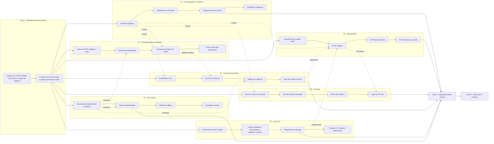
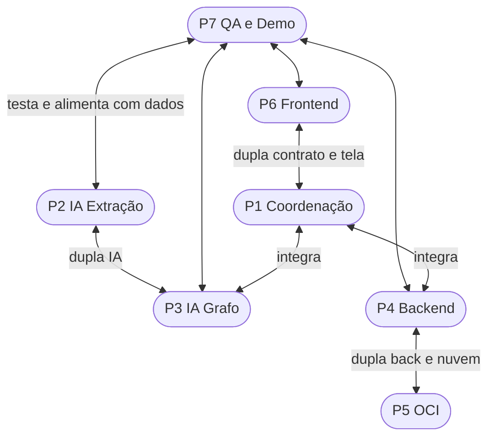

# 🏥 MediFlow — Plano de Ação da Equipe G10-BRASIL-05

> **Objetivo:** entregar o MVP do MediFlow (agente que recebe documentos clínicos, classifica, extrai dados, decide a rota e salva no OCI Object Storage) com os **3 cenários de demo**: ✅ Rotina · 🚨 Urgência · 👨‍⚕️ Ambíguo → Revisão Humana.
>
> **Regra nº 1:** ninguém trabalha sozinho. Todo trabalho é feito **em dupla**, revisado por **outra pessoa** e integrado **cedo e sempre**.

---

## 📌 1. Informações Gerais (preencher)

| Campo | Valor |
| :--- | :--- |
| Data de início | `____/____/______` |
| Data de entrega final | `____/____/______` |
| Data do ensaio da demo | `____/____/______` |
| Horário da daily (15 min) | `____:____` |
| Canal de comunicação | `______________________` |
| Link do Jira (SCRUM) | `______________________` |
| Link do repositório | `______________________` |
| LLM escolhida | `[ ] Gemini  [ ] OpenAI  [ ] Claude  [ ] Outra: ________` |
| Usar PostgreSQL no MVP? | `[ ] Sim  [ ] Não (só OCI)` |

---

## 👥 2. Papéis e Responsáveis (preencher)

Cada pessoa tem uma **frente principal** (é dona dela) e um **parceiro** (ajuda e revisa).

| # | Frente principal | Responsável | Parceiro (ajuda e revisa) | Revisa PRs de |
| :-: | :--- | :--- | :--- | :--- |
| P1 | 🧭 **Coordenação, Arquitetura & Contratos** (schemas Pydantic, integração, README) | `__________` | P6 | Todos |
| P2 | 🤖 **IA: Classificação & Extração** (prompts, LLM, leitura de PDF/imagem) | `__________` | P3 | P3 |
| P3 | 🔀 **IA: Grafo de Decisão** (LangGraph, score de confiança, urgência, revisão humana) | `__________` | P2 | P2 |
| P4 | ⚙️ **Backend API** (FastAPI: upload, endpoint de triagem, fila de auditoria) | `__________` | P5 | P5 / P6 |
| P5 | ☁️ **Infra OCI** (buckets, repositório de storage, deploy opcional) | `__________` | P4 | P4 |
| P6 | 🖥️ **Frontend** (tela de triagem + painel de auditoria) | `__________` | P1 | P4 |
| P7 | 🧪 **QA, Dados de Teste & Demo** (documentos sintéticos, testes, roteiro e vídeo) | `__________` | Todos | Todos |

### 🤝 O que é o "Parceiro"?

Cada pessoa tem **dois papéis**:
1. **Dona da frente:** responsável principal pela sua parte (ex.: P4 é dono do Backend).
2. **Parceiro de outra frente:** a "segunda pessoa" que conhece aquela parte o suficiente para ajudar e revisar.

**Para que serve, na prática** (exemplo P4 Backend + P5 OCI):

| Para quê | Exemplo |
| :--- | :--- |
| **Revisar o código** um do outro antes de ir para a `develop` | P5 revisa o PR do endpoint `/triagem` do P4 |
| **Destravar** quando alguém empacar | P4 não consegue salvar no bucket → P5 senta junto e resolve |
| **Pair programming** nas partes difíceis ou nos pontos de integração | Os dois ligam juntos o storage OCI dentro da API |
| **Cobrir ausência** se alguém faltar | P5 adoece → P4 entende o código do OCI e segue |
| **Combinar a "fronteira"** entre as frentes | Os dois decidem juntos a função `salvar_documento(...)` que o backend chama |

**Por que essas duplas?** Elas juntam frentes que **dependem diretamente uma da outra**:
- **P2 + P3 (IA):** a extração do P2 alimenta o grafo do P3.
- **P4 + P5:** a API do P4 usa o storage do P5.
- **P6 + P1:** o frontend do P6 depende do contrato JSON definido pelo P1.
- **P7 (QA):** não tem dupla fixa. Testa a entrega de todo mundo e fornece os documentos de teste.

**O que o parceiro NÃO é:**
- ❌ Dividir a tarefa ao meio: cada um continua **dono** da sua frente.
- ❌ Trabalhar o tempo todo junto: é ajuda e revisão quando precisa, mais umas sessões de pair programming nos pontos de integração.

---

## 🗺️ 3. Fluxo de Trabalho por Pessoa

> Linha contínua = sequência dentro da frente · Linha tracejada = **dependência entre pessoas** (combinar com a outra pessoa antes!)

---

## 🤝 4. Como Colaborar (mapa de duplas)

### Regras práticas de colaboração
1. **Daily de 15 min**: cada um fala *o que fez, o que vai fazer e o que está te travando*.
2. **Travou por mais de 30 min? Pede ajuda** no canal. Não fica sofrendo sozinho.
3. **Dupla fixa**: as duplas fazem pair programming nas partes difíceis e revisam o PR uma da outra.
4. **Contrato primeiro**: ninguém muda o JSON de entrada/saída sem avisar P1 e quem depende dele.
5. **Mock antes do real**: o Frontend usa JSON fake, o Backend usa um grafo fake, o Grafo usa uma LLM fake. Assim ninguém fica esperando ninguém.
6. **Integração diária**: todo fim de dia, o que está pronto vai para a `develop`.
7. **Card no Jira para tudo**: branch `feature/SCRUM-XX-descricao` → PR para `develop` → 1 revisão aprovada. Configure o Jira no seu agente de IA com o guia [AGENTS/JIRA_MCP_SETUP.md](AGENTS/JIRA_MCP_SETUP.md).
8. **Decisão importante → registrar** em `DECISIONS/<seu-usuario>/` (template em `DECISIONS/TEMPLATE.md`).

---

## 📅 5. Cronograma por Fases (preencher datas)

| Fase | O que entrega | Quem | Início | Fim | Status |
| :--- | :--- | :--- | :--- | :--- | :--- |
| **0. Alinhamento** | Decisões tomadas + contrato JSON aprovado + cards criados no Jira | Todos | `__/__` | `__/__` | `[ ]` |
| **1. Fundação** | Monorepo rodando, bucket OCI criado, FastAPI "hello", Next.js "hello", amostras de documentos | Todos | `__/__` | `__/__` | `[ ]` |
| **2. Desenvolvimento** | Cada frente entrega sua parte funcionando com mocks | Cada dono | `__/__` | `__/__` | `[ ]` |
| **3. Integração** | Fluxo ponta a ponta: upload → grafo → OCI → tela | Todos | `__/__` | `__/__` | `[ ]` |
| **4. Demo e Entrega** | README final, vídeo, 3 cenários funcionando, ensaio | Todos | `__/__` | `__/__` | `[ ]` |

---

## ✅ 6. Checklist por Pessoa

### P1 — Coordenação, Arquitetura & Contratos · Responsável: `__________`
- [ ] Facilitar o kickoff e registrar as decisões (LLM, banco, regras de urgência)
- [ ] Criar schemas Pydantic da entrada e saída (baseados no exemplo do PDF)
- [ ] Criar esqueleto de pastas `backend/` e `frontend/`
- [ ] Revisar PRs e garantir a integração diária na `develop`
- [ ] Escrever o README final (arquitetura, diagrama do grafo, como rodar)
- Observações: `______________________________________________`

### P2 — IA: Classificação & Extração · Responsável: `__________`
- [ ] Ler PDF (texto), imagem e texto puro → texto/entrada para LLM
- [ ] Nó de classificação (Receita, Laudo, Guia, Alta, Atestado)
- [ ] Nó de extração (paciente, médico/CRM, CID-10, medicamentos, dosagens, exames)
- [ ] Saída da LLM validada com o schema Pydantic
- [ ] Testes com as amostras do P7
- [ ] (Diferencial) OCR de receita manuscrita
- Observações: `______________________________________________`

### P3 — IA: Grafo de Decisão · Responsável: `__________`
- [ ] Definir `GraphState` e montar o `StateGraph`
- [ ] Nó de validação (campos obrigatórios, formato de CRM e CID)
- [ ] Cálculo do score de confiança (limite: `____`)
- [ ] Regras de urgência (lista de achados críticos: `________________`)
- [ ] Arestas condicionais: Emergência / Auditoria Humana / Fluxo Padrão
- [ ] Testes cobrindo os 3 cenários
- Observações: `______________________________________________`

### P4 — Backend API · Responsável: `__________`
- [ ] FastAPI base + `/health` + CORS para o front
- [ ] `POST /triagem` (texto ou arquivo) → executa o grafo → retorna JSON
- [ ] `GET /auditoria` (fila de revisão humana)
- [ ] `POST /auditoria/{id}` (aprovar / rejeitar / corrigir)
- [ ] Tratamento de erros e fallback para revisão humana
- [ ] Testes dos endpoints
- Observações: `______________________________________________`

### P5 — Infra OCI · Responsável: `__________`
- [ ] Criar conta OCI **Always Free** (sem nada pago!)
- [ ] Criar bucket `__________` com pastas `recebidos/`, `processados/`, `auditoria_humana/`
- [ ] Classe de repositório: `upload`, `mover entre pastas`, `listar`
- [ ] Documentar como configurar as credenciais (sem commitar segredo!)
- [ ] Ajudar o P4 a ligar o storage no fluxo
- [ ] (Diferencial) Deploy na OCI Compute
- Observações: `______________________________________________`

### P6 — Frontend · Responsável: `__________`
- [ ] Layout base e navegação
- [ ] Tela de triagem: upload + resultado (tipo, prioridade, score, dados, rota)
- [ ] Painel de auditoria: lista + detalhe + botões aprovar/rejeitar
- [ ] Destaque visual para urgência 🚨 e baixa confiança ⚠️
- [ ] Trocar mocks pela API real
- Observações: `______________________________________________`

### P7 — QA, Dados de Teste & Demo · Responsável: `__________`
- [ ] Criar documentos sintéticos em `data/samples/` (sem dados reais de pacientes!)
  - [ ] ✅ Rotina (ex.: receita simples)
  - [ ] 🚨 Urgência (ex.: laudo de TEP agudo do PDF)
  - [ ] 👨‍⚕️ Ambíguo (ex.: receita ilegível / sem CRM)
- [ ] Testar cada entrega e abrir bugs no Jira
- [ ] Roteiro da demo (quem fala o quê, ordem dos cenários)
- [ ] Gravar o vídeo e conduzir o ensaio
- Observações: `______________________________________________`

---

## 🎯 7. Definição de Pronto (vale para todos)

Uma tarefa só está **pronta** quando:
- [ ] Tem card no Jira e está ligada a uma branch/PR
- [ ] Tem teste automatizado
- [ ] Foi revisada por **outra pessoa**
- [ ] Está na `develop` e não quebrou nada
- [ ] Não tem segredo (`.env`, chaves) commitado

---

## 🚧 8. Riscos e Bloqueios (preencher durante o projeto)

| Data | Bloqueio / Risco | Quem está travado | Quem vai ajudar | Resolvido? |
| :--- | :--- | :--- | :--- | :-: |
| `__/__` | `______________________` | `______` | `______` | `[ ]` |
| `__/__` | `______________________` | `______` | `______` | `[ ]` |
| `__/__` | `______________________` | `______` | `______` | `[ ]` |

---

## 📝 9. Registro das Dailies (opcional)

| Data | Destaques | Bloqueios | Próximos passos |
| :--- | :--- | :--- | :--- |
| `__/__` | `______` | `______` | `______` |
| `__/__` | `______` | `______` | `______` |
