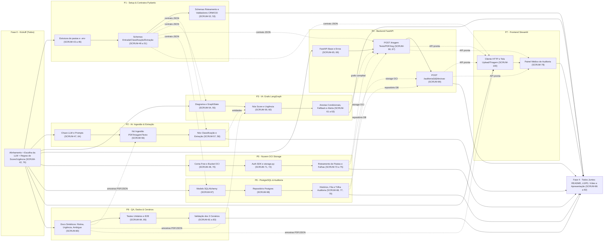
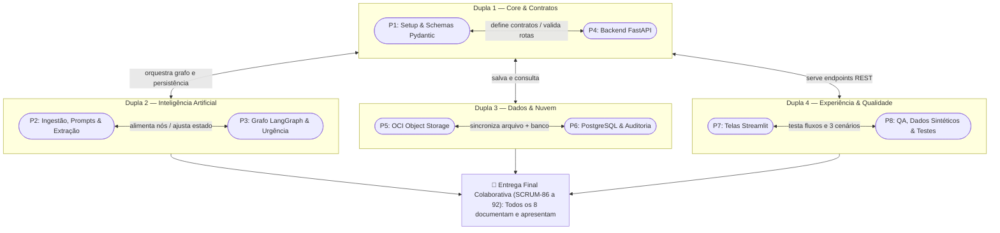

# 🏥 MediFlow — Plano de Ação Prático da Equipe G10-BRASIL-05 (8 Pessoas)

> **Objetivo:** entregar o MVP 100% funcional do **MediFlow** (stack **100% Python**: Streamlit + FastAPI + LangGraph + PostgreSQL + OCI Object Storage) cobrindo os **3 cenários obrigatórios de demo**:
> 1. ✅ **Rotina** (fluxo padrão aprovado automaticamente)
> 2. 🚨 **Urgência Médica** (ex.: TEP agudo → fila de emergência + alerta de plantão)
> 3. 👨‍⚕️ **Ambíguo / Baixa Confiança** (encaminhado para revisão médica no painel Human-in-the-Loop)
>
> **Regra nº 1:** ninguém trabalha isolado. **Todos os 8 integrantes programam**, atuam em **dupla de apoio**, documentam e **apresentam a própria parte** na entrega final.

---

## 📌 1. Informações Gerais (preencher em grupo)

| Campo | Valor |
| :--- | :--- |
| Data de início | `____/____/______` |
| Data de entrega final | `____/____/______` |
| Data do ensaio geral da demo | `____/____/______` |
| Horário da daily (15 min) | `____:____` |
| Canal de comunicação | `______________________` |
| Quadro Jira (`SCRUM`) | `https://no-country.atlassian.net` |
| Repositório GitHub | `https://github.com/No-Country-simulation/G10-BRASIL-05` |
| Stack Oficial (ADR 0004) | **Streamlit + FastAPI + LangGraph + PostgreSQL + OCI Always Free** |
| LLM escolhida | `[ ] Gemini  [ ] OpenAI  [ ] Claude  [ ] Groq/Outra: ________` |
| Limiar de score p/ revisão humana | `0.____` (ex.: `< 0.75` vai para auditoria humana) |

---

## 👥 2. Divisão das 8 Pessoas (Todos Codam + Todos Apresentam)

Cada integrante é **dono de uma frente técnica**, tem um **parceiro fixo** (para revisar PRs, destravar e fazer pair programming) e **apresenta o que construiu** na demonstração final.

| # | Frente Técnica (Mão na Massa) | Responsável | Parceiro (ajuda e revisa) | Cards Técnicos no Jira | Bloco na Apresentação Final (`SCRUM-91`) |
| :-: | :--- | :--- | :-: | :--- | :--- |
| **P1** | 🧭 **Coordenação, Setup & Contratos (Schemas Pydantic)** | `__________` | P4 | `SCRUM-42` a `46`, `49` a `53` | Problema de negócio, arquitetura geral e contratos JSON/validadores |
| **P2** | 🤖 **IA: Ingestão, Classificação & Extração (LLM)** | `__________` | P3 | `SCRUM-47`, `56`, `57`, `58`, `64` (+`96`) | Leitura multimodal (PDF/imagem/texto), prompts e extração clínica |
| **P3** | 🔀 **IA: Grafo de Decisão, Score & Urgência (LangGraph)** | `__________` | P2 | `SCRUM-54`, `55`, `59` a `63`, `76` | Máquina de estados no LangGraph, score de confiança e alerta de urgência |
| **P4** | ⚙️ **Backend API (FastAPI & Orquestração)** | `__________` | P1 | `SCRUM-65`, `66`, `67`, `69`, `99` | API REST (`POST /triagem`, upload e `POST /auditoria/{id}/decisao`) |
| **P5** | ☁️ **Infra & Nuvem (OCI Object Storage Always Free)** | `__________` | P6 | `SCRUM-48`, `70` a `75` (+`94`) | Segregação no bucket OCI (`recebidos/`, `processados/`, `auditoria_humana/`) |
| **P6** | 🗄️ **Banco de Dados & Persistência (PostgreSQL + Auditoria)** | `__________` | P5 | `SCRUM-68`, `77`, `79`, `97`, `98` | Modelagem PostgreSQL, histórico de triagens, trilha de auditoria e LGPD |
| **P7** | 🖥️ **Frontend (Streamlit: Triagem, Auditoria & Histórico)** | `__________` | P8 | `SCRUM-78`, `100` (+`93`) | Demo ao vivo nas telas de Upload/Triagem e Painel Médico Human-in-the-Loop |
| **P8** | 🧪 **QA, Dados Clínicos Sintéticos & Testes Automatizados** | `__________` | P7 | `SCRUM-80` a `85` | Demonstração dos 3 cenários (Rotina, Urgência, Ambíguo) e bateria Pytest |
| **TODOS** | 🎤 **Documentação, Vídeo & Apresentação (`SCRUM-86` a `92`)** | **Os 8 juntos** | Time todo | `SCRUM-86` a `92` | Cada um escreve a seção da sua frente no README e fala ~1,5 min na apresentação |

### 🤝 O que é o "Parceiro (ajuda e revisa)"?

Cada pessoa tem **dois papéis**:
1. **Dona da frente:** responsável principal por entregar os cards da sua linha.
2. **Parceiro da dupla:** a segunda pessoa que conhece aquela parte para revisar código, destravar rápido e programar junto nas integrações.

| Para quê serve a dupla | Exemplo prático |
| :--- | :--- |
| **Revisar Pull Request (PR)** antes do merge na `develop` | P5 revisa o PR de PostgreSQL do P6; P6 revisa o PR de OCI do P5 |
| **Destravar em até 30 min** | P2 travou no parse de PDF → chama o P3 e resolvem juntos |
| **Pair programming nas fronteiras** | P1 (Schemas) + P4 (FastAPI) ligam juntos a validação do endpoint `POST /triagem` |
| **Cobrir imprevistos** | Se alguém tiver imprevisto no dia, o parceiro sabe exatamente onde o código parou |

**As 4 duplas técnicas do time:**
- 🧠 **Dupla de IA (`P2 + P3`):** Ingestão/Extração LLM (`P2`) + Grafo de Decisão LangGraph (`P3`)
- ⚙️ **Dupla de Core & Contratos (`P1 + P4`):** Schemas Pydantic (`P1`) + Endpoints FastAPI (`P4`)
- ☁️ **Dupla de Dados & Nuvem (`P5 + P6`):** OCI Object Storage (`P5`) + PostgreSQL & Fila de Auditoria (`P6`)
- 🖥️ **Dupla de Experiência & Qualidade (`P7 + P8`):** Telas Streamlit (`P7`) + Casos Clínicos Sintéticos e Testes (`P8`)

---

## 🗺️ 3. Diagrama Mermaid — Fluxo de Trabalho das 8 Pessoas

---

## 🤝 4. Mapa das Duplas e Colaboração

### Regras Práticas do Dia a Dia
1. **Daily de 15 min**: cada um responde rapidinho: *O que entreguei? O que vou fazer hoje? Estou travado em algo?*
2. **Regra dos 30 minutos**: travou por mais de 30 min? Chama o **Parceiro da dupla** imediatamente.
3. **Contrato primeiro (`P1`)**: os schemas Pydantic (`SCRUM-49` a `52`) são a primeira entrega. Enquanto não ficam prontos, usem exatamente o JSON de exemplo do PDF (caso de TEP agudo).
4. **Mocks para ninguém esperar ninguém**:
   - `P7 (Streamlit)` começa com um JSON mockado antes da API do `P4` ficar pronta.
   - `P4 (FastAPI)` começa retornando um JSON fixo antes do grafo do `P3` ficar pronto.
   - `P3 (LangGraph)` testa as rotas condicionais com funções simuladas antes dos prompts do `P2`.
5. **Fluxo no Jira e Git**:
   - Puxar o card no Jira → atribuir para si → mover para **Em andamento (`21`)** (ver [AGENTS/JIRA_MCP_SETUP.md](AGENTS/JIRA_MCP_SETUP.md)).
   - Criar branch `feature/SCRUM-XX-descricao-curta` → abrir PR para `develop` → **Parceiro da dupla revisa e aprova**.

---

## 📅 5. Cronograma por Fases (preencher datas)

| Fase | Meta Prática | Cards Principais | Início | Fim | Status |
| :--- | :--- | :--- | :--- | :--- | :-: |
| **0. Kickoff** | Nomes preenchidos, LLM definida, limiar de confiança definido | `SCRUM-42`, `76` | `__/__` | `__/__` | `[ ]` |
| **1. Fundação** | Pastas criadas, `.env`, Schemas Pydantic prontos, Bucket OCI criado, Postgres rodando, 3 amostras clínicas criadas | `SCRUM-43` a `53`, `70`, `80`, `97` | `__/__` | `__/__` | `[ ]` |
| **2. Construção** | Nós da LLM, Grafo LangGraph, Repositórios OCI/Postgres, Endpoints FastAPI e Telas Streamlit funcionando com mocks | `SCRUM-54` a `69`, `71` a `75`, `77` a `79`, `98` a `100` | `__/__` | `__/__` | `[ ]` |
| **3. Integração & QA** | Tudo plugado ponta a ponta + bateria de testes passando nos 3 cenários (Rotina, Urgência, Ambíguo) | `SCRUM-81` a `85` (+ diferenciais `93` a `96`) | `__/__` | `__/__` | `[ ]` |
| **4. Doc & Demo** | README completo, seção LGPD, vídeo gravado e ensaio dos 8 apresentando | `SCRUM-86` a `92` | `__/__` | `__/__` | `[ ]` |

---

## ✅ 6. Checklists Individuais (100% Mapeados com o Jira)

### 🧭 P1 — Coordenação, Setup & Contratos (Schemas Pydantic)
- **Responsável:** `____________________` · **Parceiro:** `P4`
- [ ] `SCRUM-42` — Definir papéis e divisão de módulos do time (preencher este plano)
- [ ] `SCRUM-43` — Criar repositório Git e política de branches (`main` / `develop` / `feature/SCRUM-XX`)
- [ ] `SCRUM-44` — Criar estrutura de pastas do projeto (`backend/`, `frontend/`, `data/samples/`)
- [ ] `SCRUM-45` — Configurar ambiente Python e dependências (`requirements.txt`)
- [ ] `SCRUM-46` — Configurar variáveis de ambiente (`.env.example`)
- [ ] `SCRUM-49` — Modelar schema de entrada (`RequisicaoDocumento`) em `backend/app/schemas/`
- [ ] `SCRUM-50` — Modelar schemas de classificação (`ClassificacaoDocumento`)
- [ ] `SCRUM-51` — Modelar schemas de dados extraídos (`DadosExtraidos`, paciente, médico/CRM, CID)
- [ ] `SCRUM-52` — Modelar schemas de roteamento e armazenamento (`DecisaoRoteamento`, `ArmazenamentoOCI`, resposta final)
- [ ] `SCRUM-53` — Implementar validadores clínicos determinísticos (formato de CRM, CID-10 e consistência)

---

### 🤖 P2 — IA: Ingestão, Classificação & Extração (LLM Multimodal)
- **Responsável:** `____________________` · **Parceiro:** `P3`
- [ ] `SCRUM-47` — Obter chave da LLM escolhida e testar chamada simples em `backend/app/agent/config.py`
- [ ] `SCRUM-56` — Nó de ingestão e normalização (extrair texto de PDF, imagem ou JSON)
- [ ] `SCRUM-64` — Engenharia e versionamento de templates de prompts em `backend/app/agent/prompts/`
- [ ] `SCRUM-57` — Nó de classificação do documento (Receituário, Laudo, Guia TISS, Relatório de Alta, Atestado + especialidade)
- [ ] `SCRUM-58` — Nó de extração de entidades clínicas estruturadas validando com os schemas do `P1`
- [ ] *(Diferencial se sobrar tempo)* `SCRUM-96` — OCR/visão multimodal para receitas manuscritas e laudos escaneados

---

### 🔀 P3 — IA: Grafo de Decisão, Score & Urgência (LangGraph)
- **Responsável:** `____________________` · **Parceiro:** `P2`
- [ ] `SCRUM-54` — Desenhar o grafo de decisão do agente (diagrama Mermaid do fluxo clínico)
- [ ] `SCRUM-55` — Definir o estado tipado do grafo (`GraphState`) em `backend/app/agent/state.py`
- [ ] `SCRUM-76` — Definir limiares de score de confiança e critérios objetivos de revisão humana
- [ ] `SCRUM-59` — Nó de avaliação de consistência e cálculo do `score_confianca_classificacao`
- [ ] `SCRUM-60` — Nó de detecção de urgência médica (achados críticos como TEP agudo, dispneia súbita, etc.)
- [ ] `SCRUM-61` — Arestas condicionais e nó de roteamento (`Fila_Emergencia_Medica`, `Auditoria_Humana`, `Fluxo_Padrao`) em `graph.py`
- [ ] `SCRUM-62` — Regras de contingência e fallback seguro (qualquer falha ou dúvida cai para revisão humana)
- [ ] `SCRUM-63` — Geração de notificação de alerta (`Alerta_Plantao_Medico` para urgências)

---

### ⚙️ P4 — Backend API (FastAPI & Orquestração)
- **Responsável:** `____________________` · **Parceiro:** `P1`
- [ ] `SCRUM-65` — Criar aplicação FastAPI base (`backend/app/main.py`, `/health`, CORS)
- [ ] `SCRUM-66` — Endpoint `POST /triagem` (recebendo texto/JSON, chamando `triagem_service` → grafo + OCI + Postgres)
- [ ] `SCRUM-67` — Suporte a upload de arquivo PDF e imagem (`multipart/form-data`) no `POST /triagem`
- [ ] `SCRUM-99` — Endpoint `POST /auditoria/{id}/decisao` para aprovar, corrigir ou rejeitar documento em revisão humana
- [ ] `SCRUM-69` — Tratamento global de erros, exceções e logs estruturados

---

### ☁️ P5 — Infra & Nuvem (OCI Object Storage Always Free)
- **Responsável:** `____________________` · **Parceiro:** `P6`
- [ ] `SCRUM-48` — Criar conta OCI e confirmar uso estrito de recursos **Always Free**
- [ ] `SCRUM-70` — Criar bucket `mediflow-documentos-clinicos` com prefixos `recebidos/`, `processados/`, `auditoria_humana/`
- [ ] `SCRUM-71` — Configurar autenticação do SDK OCI via variáveis de ambiente
- [ ] `SCRUM-72` — Implementar repositório OCI (`backend/app/repositories/oci_storage.py`): upload e leitura de arquivos/JSONs
- [ ] `SCRUM-73` — Roteamento automático de objetos por status (`recebidos/` → `processados/urgentes/`, `processados/rotina/` ou `auditoria_humana/`)
- [ ] `SCRUM-74` — Tratamento de falhas de armazenamento e modo fallback local para desenvolvimento sem credencial OCI
- [ ] `SCRUM-75` — Monitorar uso dentro dos limites Always Free
- [ ] *(Diferencial se sobrar tempo)* `SCRUM-94` — Deploy em máquina virtual OCI Compute Always Free

---

### 🗄️ P6 — Banco de Dados & Persistência (PostgreSQL + Fila de Auditoria)
- **Responsável:** `____________________` · **Parceiro:** `P5`
- [ ] `SCRUM-97` — Configurar PostgreSQL, SQLAlchemy e modelos ORM (`backend/app/models/`)
- [ ] `SCRUM-98` — Implementar repositório PostgreSQL (`backend/app/repositories/triagem_repository.py`)
- [ ] `SCRUM-68` — Endpoints `GET /documentos` e `GET /documentos/{id}` para consulta de histórico de triagens
- [ ] `SCRUM-77` — Endpoint e serviço da fila de auditoria humana (`GET /auditoria` integrando PostgreSQL e OCI)
- [ ] `SCRUM-79` — Registro de trilha de auditoria (quem aprovou/rejeitou, quando, justificativa e dados alterados)

---

### 🖥️ P7 — Frontend (Streamlit: Triagem, Auditoria & Histórico)
- **Responsável:** `____________________` · **Parceiro:** `P8`
- [ ] `SCRUM-100` — Criar `frontend/services/api_client.py` e a **Tela Streamlit de Upload, Triagem Clínica e Histórico** (`frontend/pages/1_Triagem_Clinica.py` e `3_Historico.py`)
- [ ] `SCRUM-78` — Criar o **Painel Streamlit de Auditoria Humana** (`frontend/pages/2_Auditoria_Humana.py`) com visualização dos itens de baixa confiança e aprovação/rejeição em 1 clique
- [ ] *(Diferencial se sobrar tempo)* `SCRUM-93` — Aba de regras de triagem e limiares configuráveis pelo gestor hospitalar sem mexer no código

---

### 🧪 P8 — QA, Dados Clínicos Sintéticos & Testes Automatizados
- **Responsável:** `____________________` · **Parceiro:** `P7`
- [ ] `SCRUM-80` — Criar documentos clínicos sintéticos em `data/samples/` (PDF, imagem e JSON — **zero dados reais**):
  - Caso 1 (Rotina): Receituário ou exame simples com CRM válido e alta confiança
  - Caso 2 (Urgência): Laudo de Tomografia com Tromboembolismo Pulmonar Agudo (TEP) no Pronto-Socorro
  - Caso 3 (Ambíguo): Receita/guia com dados faltantes, CRM ausente ou texto duvidoso para cair em auditoria humana
- [ ] `SCRUM-84` — Testes unitários dos nós do agente e validadores clínicos (`backend/tests/`)
- [ ] `SCRUM-85` — Teste de integração ponta a ponta da API (`POST /triagem` e `POST /auditoria/{id}/decisao`)
- [ ] `SCRUM-81` — Validar e homologar o **Cenário 1: fluxo padrão aprovado**
- [ ] `SCRUM-82` — Validar e homologar o **Cenário 2: urgência médica**
- [ ] `SCRUM-83` — Validar e homologar o **Cenário 3: caso ambíguo para auditoria humana**
- [ ] *(Diferencial se sobrar tempo)* `SCRUM-95` — Workflow n8n para disparar alerta em tempo real (Slack/e-mail)

---

## 🎤 7. Tarefas Coletivas: Documentação e Apresentação (Todos os 8)

> Ninguém fica só fazendo slide e ninguém escapa de apresentar: **cada um escreve a sua parte no README e apresenta ~1,5 minuto na demo final**.

| Card | Entrega | Quem lidera | Como todos participam |
| :--- | :--- | :--- | :--- |
| `SCRUM-86` | **README com arquitetura e instruções de execução** | P1 + P4 | Cada pessoa revisa o comando de rodar a própria camada (Backend, Streamlit, Postgres, OCI) |
| `SCRUM-87` | **Diagrama do fluxo de decisão do agente** | P2 + P3 | Dupla de IA exporta o diagrama Mermaid do LangGraph e inclui no README |
| `SCRUM-88` | **Documentar contrato da API e exemplos JSON** | P1 + P4 | Exemplos reais de requisição e resposta dos 3 cenários |
| `SCRUM-89` | **Seção de LGPD, limitações e riscos clínicos** | P6 + P8 | Explicar uso de dados sintéticos, anonimização, trilha de auditoria e por que a IA não substitui o médico |
| `SCRUM-90` | **Gravar vídeo de demonstração dos 3 cenários** | P7 + P8 | Mostrar na tela do Streamlit: (1) Rotina, (2) Urgência TEP Agudo e (3) Ambíguo → Aprovação na Auditoria |
| `SCRUM-91` | **Apresentação final do projeto (Pitch + Demo)** | **Todos (P1 a P8)** | Roteiro dividido em 8 falas curtas (ver tabela abaixo) |
| `SCRUM-92` | **Checklist final contra o PDF do desafio** | **Todos (P1 a P8)** | Conferência coletiva de todos os itens obrigatórios antes da submissão |

### 🎙️ Roteiro Sugerido da Apresentação Final (Todos falam!)

| Ordem | Quem fala | Tema (1 a 1,5 min cada) |
| :-: | :--- | :--- |
| 1º | **P1** | Dor do hospital/operadora, visão geral do MediFlow e contratos de dados validados |
| 2º | **P2** | Como o agente lê PDF/imagem/texto e extrai entidades médicas com LLM multimodal |
| 3º | **P3** | Como o grafo LangGraph calcula o score de confiança e separa Rotina, Urgência e Revisão Humana |
| 4º | **P4** | Arquitetura da API FastAPI orquestrando agente, banco e nuvem com segurança |
| 5º | **P5** | Armazenamento no OCI Object Storage (Always Free) segregado por pastas de status |
| 6º | **P6** | Persistência no PostgreSQL, rastreabilidade da fila de auditoria e conformidade com LGPD |
| 7º | **P7** | **Demo ao vivo no Streamlit (Parte 1):** envio dos casos de Rotina e Urgência (alerta crítico) |
| 8º | **P8** | **Demo ao vivo no Streamlit (Parte 2):** caso Ambíguo caindo no painel Human-in-the-Loop, aprovação médica e resultados de testes |

---

## 🎯 8. Definição de Pronto (DoD)

Uma tarefa só muda para **Concluído (`41`)** no Jira quando:
- [ ] O código segue a estrutura de pastas do [AGENTS/AGENTS.md](AGENTS/AGENTS.md)
- [ ] Tem teste automatizado passando (`pytest`)
- [ ] O Pull Request foi revisado e aprovado pelo **Parceiro da dupla**
- [ ] Foi integrado na branch `develop` sem quebrar o que já estava funcionando
- [ ] Nenhum segredo (`.env`, chaves de API ou `.pem` da OCI) foi commitado

---

## 🚧 9. Quadro de Bloqueios e Riscos (preencher nas dailies)

| Data | Bloqueio / Dúvida | Card | Quem está travado | Quem vai ajudar | Resolvido? |
| :--- | :--- | :--- | :--- | :--- | :-: |
| `__/__` | `___________________________` | `SCRUM-__` | `______` | `______` | `[ ]` |
| `__/__` | `___________________________` | `SCRUM-__` | `______` | `______` | `[ ]` |
| `__/__` | `___________________________` | `SCRUM-__` | `______` | `______` | `[ ]` |
