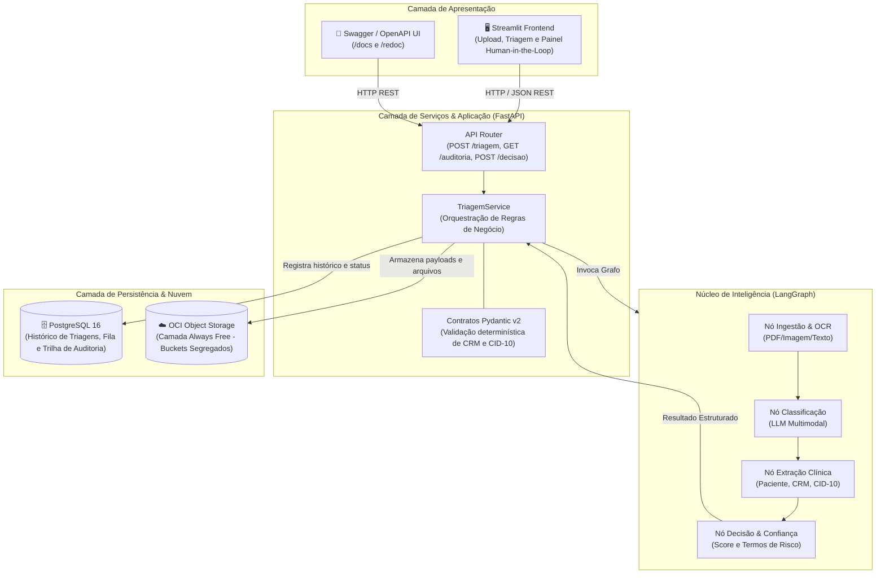
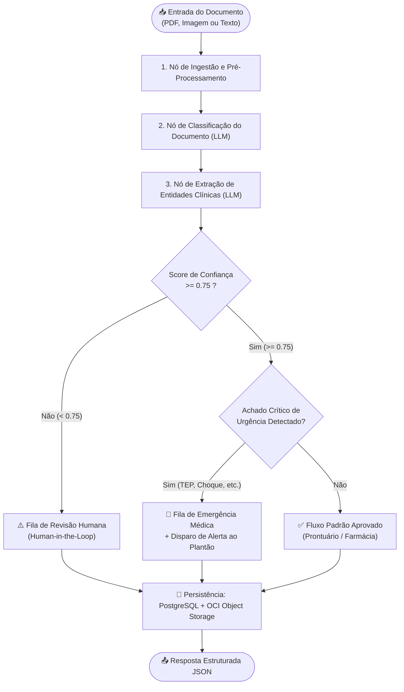
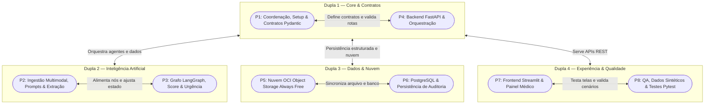

# 🏥 MediFlow — Agente Autônomo para Triagem, Extração e Roteamento de Documentos Clínicos

[](https://www.oracle.com/br/education/oracle-next-education/)
[](https://www.alura.com.br/)
[](https://www.python.org/)
[](https://fastapi.tiangolo.com/)
[](https://langchain-ai.github.io/langgraph/)
[](https://www.postgresql.org/)
[](https://www.oracle.com/cloud/free/)
[](https://streamlit.io/)

> **Projeto desenvolvido no Hackathon ONE (Oracle Next Education & Alura) / Simulação No-Country**  
> **Equipe G10-BRASIL-05** — 8 Desenvolvedores com atuação integrada em duplas técnicas.

---

## 📑 Sumário

- [Visão Geral e Dor de Negócio](#-visão-geral-e-dor-de-negócio)
- [A Solução MediFlow](#-a-solução-mediflow)
- [Os 3 Cenários da Demonstração](#-os-3-cenários-da-demonstração)
- [Arquitetura do Sistema](#-arquitetura-do-sistema)
- [Grafo de Decisão do Agente (LangGraph)](#-grafo-de-decisão-do-agente-langgraph)
- [Stack Tecnológica](#-stack-tecnológica)
- [Estrutura do Repositório](#-estrutura-do-repositório)
- [Contratos da API REST (Endpoints e Payloads)](#-contratos-da-api-rest)
- [Como Executar o Projeto Localmente](#-como-executar-o-projeto-localmente)
- [Nuvem: Oracle Cloud Infrastructure (OCI Always Free)](#-nuvem-oracle-cloud-infrastructure-oci-always-free)
- [Segurança, Trilha de Auditoria e LGPD](#-segurança-trilha-de-auditoria-e-lgpd)
- [Equipe e Governança do Projeto](#-equipe-e-governança-do-projeto)

---

## 💡 Visão Geral e Dor de Negócio

No ecossistema de saúde (hospitais, operadoras e clínicas), milhares de documentos heterogêneos circulam diariamente: laudos radiológicos, receituários médicos, guias de solicitação TISS/TUSS e relatórios de alta.

### O Problema
- **Triagem Manual Morosa:** Equipes de enfermagem e administrativas gastam horas lendo papéis e PDFs para redigitar dados em sistemas de prontuário eletrônico.
- **Risco de Vida em Achados Críticos:** Laudos com achados de emergência (ex.: *Tromboembolismo Pulmonar Agudo - TEP*) podem ficar represados em filas assíncronas aguardando conferência humana, atrasando condutas vitais.
- **Glosas Hospitalares e Inconsistências:** Erros de digitação de CRM, ausência de CID-10 e prescrições ilegíveis geram glosas financeiras e atrasos em autorizações.

### A Oportunidade
O **MediFlow** transforma esse processo em um fluxo autônomo, inteligente e auditável. Utilizando **visão multimodal e Modelos de Linguagem (LLMs)** orquestrados por **grafos de decisão (LangGraph)**, a plataforma ingere documentos em múltiplos formatos, extrai entidades com precisão clínica, calcula scores de confiabilidade e direciona automaticamente o caso para a fila adequada, mantendo o médico no circuito (*Human-in-the-Loop*) sempre que necessário.

---

## 🎯 A Solução MediFlow

O sistema oferece um ciclo completo de triagem clínica:

1. **Ingestão Multimodal:** Suporte a arquivos PDF digitais/digitalizados, imagens escaneadas e payloads em texto puro/JSON.
2. **Classificação e Extração Semântica:** Identificação do tipo documental (Laudo, Receita, Atestado, Guia TISS) e extração de entidades-chave (Paciente, CRM do médico, Especialidade, Hipótese Diagnóstica, CID-10, Exames solicitados).
3. **Avaliação Contínua de Risco e Confiança:** Algoritmo que pondera completude dos dados, legibilidade e termos sentinela de urgência.
4. **Roteamento Inteligente:** Direcionamento automatizado para Fila Padrão, Fila de Emergência ou Fila de Auditoria Humana.
5. **Persistência Híbrida e Segura:** Registro relacional no **PostgreSQL 16** para histórico e auditoria, e backup segregado de arquivos e JSONs no **OCI Object Storage Always Free**.

---

## 🎬 Os 3 Cenários da Demonstração

O MediFlow foi projetado para cobrir com excelência os 3 cenários clínicos fundamentais exigidos pelo desafio:

| Cenário | Descrição Clínica | Score de Confiança | Destino do Roteamento | Ação Automática |
| :--- | :--- | :---: | :--- | :--- |
| **1. Rotina** | Consulta de rotina, dados legíveis e conformidade cadastral total. | **Alto** ($\ge 0.75$) | `Fluxo_Padrao` / Prontuário | Triagem aprovada sem intervenção humana. Arquivamento em `processados/rotina/`. |
| **2. Urgência Médica** | Laudo com achado crítico grave (ex.: *Tromboembolismo Pulmonar Agudo - TEP*). | **Alto** ($\ge 0.75$) | `Fila_Emergencia_Medica` | Notificação imediata para `Alerta_Plantao_Medico` e envio prioritário à equipe de socorro. |
| **3. Ambíguo / Baixa Confiança** | Documento ilegível, dados cadastrais conflitantes ou CRM duvidoso. | **Baixo** ($< 0.75$) | `Fila_Auditoria_Humana` | Encaminhamento para o painel médico *Human-in-the-Loop* para aprovação/correção manual. |

---

## 🏗️ Arquitetura do Sistema

A solução adota arquitetura desacoplada em monorepo com contratos fortemente tipados em **Pydantic v2**:



---

## 🤖 Grafo de Decisão do Agente (LangGraph)

O fluxo do agente é estruturado como uma máquina de estados finita no **LangGraph**, avaliando cada etapa com arestas condicionais:



---

## 🛠️ Stack Tecnológica

| Camada | Tecnologia | Justificativa |
| :--- | :--- | :--- |
| **Linguagem Principal** | Python 3.11+ | Unificação de todo o ecossistema (Backend, IA e Frontend) em uma única linguagem, acelerando a entrega do time. |
| **API Backend** | FastAPI | Alta performance assíncrona, documentação OpenAPI nativa (`/docs`) e validação via Pydantic. |
| **Modelos & Schemas** | Pydantic v2 & Pydantic-Settings | Contratos de dados estritos com validadores regex de CRM brasileiro e formatos de CID-10. |
| **Agente e Orquestração** | LangGraph & LangChain Core | Máquina de estados orientada a grafos com suporte a arestas condicionais, auditoria e controle de fluxo. |
| **Modelos de IA (LLMs)** | Google Gemini / OpenAI GPT-4o / Claude | Capacidade multimodal para leitura de laudos e receitas em PDF escaneado ou foto, e extração em JSON estruturado. |
| **Banco de Dados** | PostgreSQL 16 (SQLAlchemy 2.0) | Banco relacional robusto para armazenar histórico de documentos, fila de auditoria e decisões de médicos. |
| **Armazenamento em Nuvem**| Oracle Cloud Infrastructure (OCI Always Free) | Buckets no OCI Object Storage com segregação de pastas conforme requisitos do Hackathon ONE. |
| **Frontend** | Streamlit | Interface interativa e intuitiva para demonstração de uploads, triagens em tempo real e painel médico Human-in-the-Loop. |
| **Containerização** | Docker & Docker Compose | Inicialização rápida e isolada de todos os serviços de suporte (PostgreSQL e API). |
| **Testes e Qualidade** | Pytest, Pytest-Asyncio, HTTPX | Testes automatizados unitários e de integração para validação de endpoints e regras clínicas. |

---

## 📁 Estrutura do Repositório

```text
G10-BRASIL-05/
├── .github/                       # Workflows e automações de CI/CD
├── AGENTS/                        # Diretrizes para agentes de IA e setup do Jira MCP
│   ├── AGENTS.md                  # Regras de código, Clean Architecture e convenções
│   ├── JIRA_MCP_SETUP.md          # Manual de configuração do MCP Jira Cloud
│   └── SKILLS/                    # Protocolos (Grill-Me Protocol)
├── backend/                       # Núcleo da API REST e Agente Inteligente
│   ├── app/
│   │   ├── agent/                 # LangGraph: Grafos, estados, nós e prompts
│   │   │   ├── nodes/             # Implementações individuais dos nós de IA
│   │   │   ├── prompts/           # Prompts versionados para classificação e extração
│   │   │   ├── config.py          # Configurações de LLMs e termos de urgência
│   │   │   ├── graph.py           # Definição e compilação do StateGraph
│   │   │   └── state.py           # Estado tipado (GraphState)
│   │   ├── config/                # Settings e variáveis de ambiente via Pydantic
│   │   │   └── settings.py
│   │   ├── controllers/           # Endpoints HTTP FastAPI (triagem, auditoria)
│   │   │   └── triagem.py
│   │   ├── models/                # Modelos ORM SQLAlchemy para PostgreSQL
│   │   │   └── triagem.py
│   │   ├── repositories/          # Camada de I/O (PostgreSQL e OCI Storage)
│   │   │   ├── database.py
│   │   │   └── storage.py
│   │   ├── schemas/               # Contratos Pydantic de entrada, saída e auditoria
│   │   │   └── triagem.py
│   │   ├── services/              # Orquestrador da lógica de negócio e triagem
│   │   │   └── triagem.py
│   │   ├── __init__.py
│   │   └── main.py                # Ponto de entrada FastAPI com CORS e lifespan
│   ├── tests/                     # Bateria de testes automatizados com Pytest
│   │   ├── test_health.py
│   │   └── __init__.py
│   ├── .env.example               # Template de variáveis de ambiente
│   ├── Dockerfile                 # Imagem Docker do backend
│   └── requirements.txt           # Dependências Python fixadas
├── DECISIONS/                     # Architecture Decision Records (ADRs)
│   ├── patrickgutem-create/
│   │   ├── 0001-integracao-jira-mcp.md
│   │   ├── 0002-arquitetura-monorepo-desacoplado.md
│   │   ├── 0003-atribuicao-automatica-tarefas-jira.md
│   │   └── 0004-adocao-streamlit-e-postgresql.md
│   └── TEMPLATE.md                # Template padronizado de decisões
├── DOCUMENTOS/                    # Documentação oficial, cronogramas e PDFs do desafio
│   ├── mediflow (1).pdf           # Edital oficial do desafio Hackathon ONE
│   ├── PLANO_DE_ACAO.md           # Divisão dos 8 papéis (P1 a P8) e duplas de suporte
│   └── CRONOGRAMA_DIARIO_DETALHADO.md
├── docker-compose.yml             # Orquestração local do PostgreSQL 16
├── .gitignore
└── README.md                      # Documentação principal da solução
```

---

## 📡 Contratos da API REST

A API expõe rotas versionadas sob o prefixo `/api/v1` (com alias direto `/triagem` para facilidade de consumo).

### Principais Endpoints

| Método | Rota | Descrição |
| :---: | :--- | :--- |
| `GET` | `/health` | Health check da API e verificação de conexão com banco de dados. |
| `POST` | `/triagem` | **Endpoint principal de triagem:** ingere o documento, classifica, extrai dados clínicos e calcula o roteamento. |
| `GET` | `/triagem/documentos` | Consulta o histórico de triagens realizadas com paginação. |
| `GET` | `/triagem/auditoria` | Lista documentos com score baixo aguardando avaliação médica (*Human-in-the-Loop*). |
| `POST` | `/triagem/auditoria/{id}/decisao` | Registra a decisão médica humana (aprovação, correção ou rejeição) para um documento em auditoria. |

---

### Exemplo de Requisição (`POST /triagem`)

**Payload de Entrada (Caso de Urgência Médica - TEP Agudo):**

```json
{
  "documento_id": "DOC-CLIN-2026-8942",
  "tipo_arquivo": "PDF",
  "documento_texto": "HOSPITAL SANTA LUCIA - LAUDO DE EXAME RADIOLOGICO. Paciente: Carlos Eduardo Mendes, 52 anos. Solicitante: Dra. Renata Silveira CRM-SP 145892. Exame: Tomografia de Torax com contraste. Indicacao: Suspeita de embolia pulmonar aguda, dispneia subita. Achados: Falha de enchimento em arteria pulmonar principal direita compativel com TEP agudo. CONCLUSÃO: Quadro compativel com Tromboembolismo Pulmonar Agudo. Sugere-se correlacao clinica urgente.",
  "canal_origem": "Pronto_Socorro"
}
```

---

### Exemplo de Resposta Estruturada

**Saída JSON validada via Pydantic:**

```json
{
  "status": "processado",
  "documento_id": "DOC-CLIN-2026-8942",
  "classificacao": {
    "tipo_documento": "Laudo de Exame de Imagem",
    "especialidade": "Radiologia / Pneumologia",
    "nivel_prioridade": "Urgente",
    "score_confianca_classificacao": 0.99
  },
  "dados_extraidos": {
    "paciente": {
      "nome": "Carlos Eduardo Mendes",
      "idade": 52
    },
    "medico_solicitante": {
      "nome": "Dra. Renata Silveira",
      "crm": "145892-SP"
    },
    "exame_realizado": "Tomografia de Torax com contraste",
    "diagnostico_principal": "Tromboembolismo Pulmonar Agudo (TEP)",
    "cid_sugerido": "I26.9"
  },
  "decisao_roteamento": {
    "destino_principal": "Fila_Emergencia_Medica",
    "requer_auditoria_humana": false,
    "justificativa_roteamento": "Achado critico de alta gravidade detectado em paciente sintomatico.",
    "notificacao_gerada": {
      "canal": "Alerta_Plantao_Medico",
      "mensagem": "ALERTA URGENTE: Laudo critico detectado para DOC-CLIN-2026-8942 no Pronto_Socorro."
    }
  },
  "armazenamento_oci": {
    "bucket": "mediflow-documentos-clinicos",
    "caminho_objeto": "processados/urgentes/DOC-CLIN-2026-8942.json",
    "status_backup": "sucesso"
  }
}
```

---

## 🚀 Como Executar o Projeto Localmente

### Pré-requisitos
- **Git**
- **Python 3.11+**
- **Docker** e **Docker Compose**
- Chave de API de LLM (ex.: `GOOGLE_API_KEY` do Google AI Studio ou `OPENAI_API_KEY`)

---

### Passo 1: Clonar o Repositório e Configurar Variáveis de Ambiente

```bash
git clone https://github.com/No-Country-simulation/G10-BRASIL-05.git
cd G10-BRASIL-05

# Copiar arquivo de variáveis de ambiente do backend
cp backend/.env.example backend/.env
```

Edite o arquivo `backend/.env` preenchendo sua chave de LLM (`GOOGLE_API_KEY`) e as credenciais desejadas para o banco.

---

### Passo 2: Inicializar o Banco de Dados (PostgreSQL 16)

O banco é executado via Docker Compose:

```bash
# Definir variáveis de ambiente locais para o Docker Compose ou criar um .env na raiz:
export DB_USER=postgres
export DB_PASSWORD=postgres
export DB_NAME=mediflow_db
export DB_PORT=5432

# Iniciar o container PostgreSQL
docker compose up -d postgres
```

Verifique se o container está saudável:

```bash
docker compose ps
```

---

### Passo 3: Configurar o Ambiente Python do Backend

Recomenda-se o uso de um ambiente virtual isolado:

```bash
cd backend

# Criar e ativar o ambiente virtual
python3 -m venv .venv
source .venv/bin/activate  # No Windows: .venv\Scripts\activate

# Instalar dependências
pip install --upgrade pip
pip install -r requirements.txt
```

---

### Passo 4: Executar o Servidor FastAPI

Com o ambiente virtual ativo e o banco rodando:

```bash
uvicorn app.main:app --reload --host 0.0.0.0 --port 8000
```

Acesse a documentação interativa:
- **Swagger UI:** [http://localhost:8000/docs](http://localhost:8000/docs)
- **Redoc:** [http://localhost:8000/redoc](http://localhost:8000/redoc)
- **Health Check:** [http://localhost:8000/health](http://localhost:8000/health)

---

### Passo 5: Executar os Testes Automatizados

Com o ambiente virtual ativado na pasta `backend/`:

```bash
pytest -v
```

---

### Passo 6: Executar a Aplicação Streamlit (Frontend)

O frontend consome a API do backend:

```bash
# Execução da interface gráfica
streamlit run frontend/app.py
```

---

## ☁️ Nuvem: Oracle Cloud Infrastructure (OCI Always Free)

Em total conformidade com a natureza social e 100% gratuita do **Programa ONE**, a persistência em nuvem utiliza **exclusivamente a camada Always Free da OCI**.

### Organização de Pastas no Bucket do OCI Object Storage:
- `recebidos/`: Ingestão bruta de documentos (PDFs e imagens originais).
- `processados/rotina/`: Documentos de fluxo padrão com laudos e JSONs consolidados.
- `processados/urgentes/`: Casos críticos com alertas emitidos para pronta resposta.
- `auditoria_humana/`: Casos com baixa confiança encaminhados ao painel médico para resolução.

O repositório do backend conta com modo resiliente (*fallback gracioso*): caso as credenciais da OCI não estejam configuradas localmente no ambiente do desenvolvedor, o serviço opera em modo simulado sem travar a execução do fluxo de triagem.

---

## 🔒 Segurança, Trilha de Auditoria e LGPD

Tratando-se de dados sensíveis de saúde, o MediFlow implementa medidas rigorosas de governança:

1. **Dados Sintéticos em Desenvolvimento:** Todos os testes, exemplos de documentação e amostras utilizam nomes fictícios de pacientes e médicos simulados gerados para fins educacionais e de demonstração.
2. **Trilha de Auditoria Imutável (*Audit Trail*):** Toda triagem recebe identificador único (`documento_id`), data/hora de ingestão, carimbo de decisão e registro do auditor humano responsável em caso de intervenção (`POST /triagem/auditoria/{id}/decisao`).
3. **Princípio da Não-Substituição Médica:** O agente autônomo opera como **co-piloto e suporte operacional** à triagem e roteamento de fluxo; diagnósticos clínicos finais e decisões de conduta médica permanecem sob estrita responsabilidade de médicos devidamente habilitados.

---

## 👥 Equipe e Governança do Projeto

O projeto é mantido colaborativamente pelos 8 integrantes da equipe **G10-BRASIL-05**, distribuídos em 4 duplas técnicas especializadas:



### Papéis Técnicos

| # | Integrante / Frente | Responsabilidades Principais |
| :-: | :--- | :--- |
| **P1** | **Setup & Contratos Pydantic** | Estruturação do monorepo, contratos tipados, validadores de CRM e CID-10 (`SCRUM-42` a `53`). |
| **P2** | **IA: Ingestão & Extração Multimodal** | Leitura de PDFs/imagens, engenharia de prompts e extração de entidades clínicas com LLM (`SCRUM-47`, `56` a `58`, `64`). |
| **P3** | **IA: Grafo de Decisão (LangGraph)** | Máquina de estados clínicos, arestas condicionais, cálculo de confiança e nós de urgência (`SCRUM-54`, `55`, `59` a `63`). |
| **P4** | **Backend API (FastAPI)** | Construção dos endpoints REST, injeção de dependências e orquestração do pipeline (`SCRUM-65` a `67`, `69`, `99`). |
| **P5** | **Infraestrutura OCI (Object Storage)** | Segregação dos buckets Always Free, autenticação via SDK OCI e políticas de upload (`SCRUM-48`, `70` a `75`). |
| **P6** | **Banco de Dados & Trilha de Auditoria** | Modelagem SQLAlchemy, migrações PostgreSQL, repositórios de dados e fila Human-in-the-Loop (`SCRUM-68`, `77`, `79`, `97`, `98`). |
| **P7** | **Frontend (Streamlit)** | Construção das telas de upload, visualização de triagem e painel médico para aprovação/correção (`SCRUM-78`, `100`). |
| **P8** | **QA, Dados Clínicos & Bateria de Testes** | Criação de amostras clínicas sintéticas, cobertura de testes unitários/E2E com Pytest (`SCRUM-80` a `85`). |

### Gestão e Rastreabilidade
- **Quadro Jira Scrum:** Acompanhamento do backlog (`SCRUM-33` a `SCRUM-100`) integrado via **MCP (Model Context Protocol)**.
- **Architecture Decision Records (ADRs):** Decisões arquiteturais documentadas em [`DECISIONS/`](DECISIONS/).
- **Política de Branches:** Desenvolvimento isolado em `feature/SCRUM-XX-nome`, revisado em pares antes do merge na branch de desenvolvimento.

---

## 📜 Licença

Projeto desenvolvido para fins educacionais e de demonstração no âmbito do **Hackathon ONE — Oracle Next Education & Alura** / **No-Country Simulation**.
