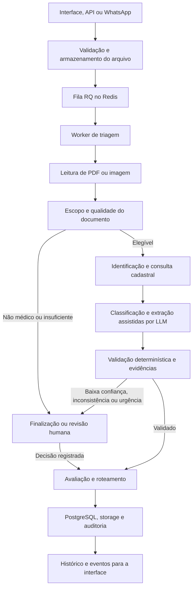

<p align="center"></p>

<div align="center">

# Triagem e Roteamento Inteligente de Documentos Clínicos


**Plataforma híbrida e resiliente para ingestão multimodal, classificação determinística, extração estruturada de dados clínicos e roteamento hospitalar com validação *Human-in-the-Loop*.**

[Aplicação em produção](https://129.146.58.37.sslip.io) • [Arquitetura](#arquitetura) • [Execução local](#executar-localmente) • [Documentação técnica](#documentação-técnica)

</div>

## Visão geral

O MediFlow é uma plataforma de apoio à triagem de documentos clínicos. Recebe texto, PDFs e imagens, prepara o conteúdo para análise, identifica o tipo e os dados explícitos do documento, valida resultados com regras determinísticas e propõe encaminhamentos. Casos ilegíveis, inconsistentes, urgentes ou com baixa confiança são direcionados para revisão humana.

O sistema integra uma interface web, uma API, processamento assíncrono, persistência relacional e documental, armazenamento de arquivos e um canal opcional de WhatsApp. A LLM auxilia na leitura e estruturação; ela não substitui a validação do software nem a decisão de profissionais.

> **Importante:** o MediFlow é uma ferramenta de apoio operacional e não fornece diagnóstico ou decisão clínica autônoma. As extrações e classificações precisam ser verificadas pelos profissionais responsáveis.

## O que a plataforma oferece

- Envio e inspeção de documentos PDF e imagens, além de entrada de texto.
- Classificação documental e extração de informações clínicas em formato estruturado.
- Validação de campos, evidências textuais e regras de consistência no backend.
- Revisão humana com aprovação, correção, rejeição ou solicitação de reenvio.
- Roteamento por tipo, prioridade e resultado da triagem.
- Acompanhamento de trabalhos, eventos em tempo real e histórico de documentos.
- Cadastro e consulta do ecossistema de pacientes, profissionais e estabelecimentos.
- Integração opcional com WhatsApp via Evolution API.
- Autenticação com JWT, perfis de acesso e troca obrigatória de senha quando aplicável.

## Como funciona a triagem



1. **Entrada:** a API valida o formato e recebe texto ou arquivo. O original pode ser guardado no storage configurado; trabalhos assíncronos são publicados na fila.
2. **Leitura:** o parser tenta obter texto nativo de PDFs e prepara conteúdo visual para inspeção. Imagens podem ser lidas pelo modelo multimodal quando o modelo configurado suporta imagens.
3. **Elegibilidade e qualidade:** o fluxo verifica se o material está no escopo médico e se há legibilidade suficiente. Conteúdo incerto não segue como se fosse uma leitura confiável.
4. **Identificação:** são extraídos identificadores explicitamente presentes e, quando configurado, consultados cadastros relacionais. O cadastro não deve ser usado para inventar fatos ausentes no documento.
5. **Classificação e extração:** a LLM retorna dados estruturados para validação, incluindo tipo documental, prioridade e campos clínicos encontrados.
6. **Validação:** schemas, validadores e evidências verificam estrutura, formatos e suporte no conteúdo. Resultados que não passam pelos critérios são encaminhados para revisão.
7. **Revisão e roteamento:** um profissional autorizado pode aprovar, corrigir, rejeitar ou solicitar reenvio. O fluxo é retomado com a decisão registrada e o resultado é persistido.

## Arquitetura

| Componente | Responsabilidade |
|---|---|
| **Frontend — Streamlit** | Login, triagem, análise, auditoria humana, histórico, gestão de usuário e conexão do WhatsApp. |
| **Backend — FastAPI** | API HTTP, autenticação e autorização, validação dos contratos, orquestração dos serviços e documentação OpenAPI. |
| **Workers — RQ** | Consumo de tarefas assíncronas de triagem e processamento das mensagens recebidas pelo canal WhatsApp. |
| **LangGraph** | Coordenação do estado e das etapas especializadas da triagem, com checkpoints para pausa e retomada de revisão. |
| **PostgreSQL** | Dados relacionais do ecossistema clínico, estado atual dos documentos e checkpoint durável do grafo. |
| **Redis** | Fila de trabalhos, locks, idempotência e publicação/snapshot de eventos de progresso. |
| **MongoDB** | Eventos de auditoria em documentos flexíveis, consultados por documento e data. |
| **OCI Object Storage ou storage local** | Armazenamento dos documentos originais e artefatos, conforme configuração. |
| **Evolution API** | Integração opcional com WhatsApp, recebimento de mensagens por webhook e envio de respostas. |

### Fluxo da LLM e do grafo

O backend usa um adaptador LangChain compatível com OpenAI apontado para a OpenRouter. O modelo vem de `OPENROUTER_MODEL`; o valor de exemplo é `openrouter/free`. O adaptador pode alternar entre chaves configuradas ao detectar limite de requisições (HTTP 429). Classificação e extração validam a saída e têm caminhos heurísticos para algumas falhas; uma falha de leitura multimodal pode exigir revisão manual.

O grafo separa etapas de qualidade, identificação, classificação, extração, validação, avaliação de risco, revisão, roteamento e finalização. As transições são condicionais: por exemplo, elegibilidade insuficiente encerra ou revisa o caso, enquanto problemas de validação podem pausar o grafo. O identificador do documento é usado para recuperar o checkpoint PostgreSQL e retomar o fluxo após uma decisão humana. O limiar de confiança é configurável por `CONFIDENCE_THRESHOLD` (exemplo: `0.80`).

Os documentos são conteúdo não confiável. Prompts e validações orientam o sistema a não seguir instruções contidas no arquivo nem inventar campos; a saída da LLM permanece sujeita a verificação. A plataforma não treina nem hospeda um modelo próprio.

### Bancos e armazenamento

- **PostgreSQL:** entidades e relações clínicas, documentos, revisões, destinos, registros operacionais e checkpoints do LangGraph. O schema é versionado com Alembic.
- **Redis:** dados operacionais e temporários para fila RQ, eventos, locks de revisão e idempotência; não é o registro clínico permanente.
- **MongoDB:** coleção de eventos de auditoria com payload flexível. A documentação técnica registra detalhes e pontos de atenção sobre consistência entre trilhas SQL e NoSQL.
- **Arquivos:** o repositório abstrai storage local e OCI Object Storage. A configuração e as credenciais disponíveis determinam o destino utilizado.
- **Evolution API:** mantém seu banco lógico PostgreSQL separado do banco do MediFlow, ainda que o Compose use o mesmo serviço PostgreSQL.

Consulte os diagramas e o inventário de dados em `DOCUMENTOS/ARQUITETURA_DOS_BANCOS_E_NORMALIZACAO.md` e `DOCUMENTOS/diagrama_postgresql.dbml`.

## Interface e perfis

A aplicação Streamlit apresenta páginas para login, triagem clínica, auditoria/revisão, histórico, análise, usuário e integração WhatsApp. A navegação é ajustada ao perfil autenticado. A integração WhatsApp também prevê conta institucional com uma interface direcionada à conexão.

A API publica documentação interativa em `/docs` e `/redoc`. As rotas principais cobrem autenticação, envio e inspeção de documentos, trabalhos e eventos da triagem, histórico, auditoria e consultas do ecossistema clínico. O prefixo padrão versionado é `/api/v1`; o backend também registra caminhos legados sem prefixo.

## Tecnologias

- Python 3.11 ou superior
- Streamlit no frontend
- FastAPI, Pydantic e SQLAlchemy no backend
- LangChain e LangGraph para integração e orquestração de IA
- PostgreSQL, Redis e MongoDB
- Alembic para migrações
- Docker Compose para desenvolvimento e operação integrada
- OpenRouter para acesso a modelos de linguagem
- Oracle Cloud Infrastructure Object Storage e Evolution API como integrações configuráveis

## Executar localmente

### Pré-requisitos

- Docker e Docker Compose
- Git
- Credenciais de provedor LLM para executar a classificação e extração assistidas por modelo
- Credenciais OCI somente se for usar Object Storage remoto

### 1. Preparar as variáveis

Na raiz do projeto, crie os arquivos privados de ambiente a partir dos exemplos:

```bash
cp .env.example .env
cp backend/.env.example backend/.env
cp frontend/.env.example frontend/.env
```

Configure valores coerentes nos arquivos, em especial as credenciais do PostgreSQL, `JWT_SECRET_KEY`, os dados de bootstrap do administrador e `OPENROUTER_API_KEY`. Para produção, use segredos aleatórios fortes e nunca os versione. O exemplo Compose habilita o profile `infra`, que inclui PostgreSQL, Redis, MongoDB, Evolution API e worker.

### 2. Iniciar a plataforma

```bash
docker compose --profile infra up --build
```

O frontend fica normalmente em `http://localhost:8501`, a API em `http://localhost:8000` e a documentação OpenAPI em `http://localhost:8000/docs`. As portas podem ser alteradas no `.env` da raiz. A inicialização do backend exige PostgreSQL disponível para as migrações e para o checkpoint durável do LangGraph.

Para parar os serviços:

```bash
docker compose --profile infra down
```

Os volumes nomeados preservam dados entre reinicializações. Para apagar volumes e dados locais, use `docker compose --profile infra down -v` com cuidado.

### Acesso inicial

O seeder pode criar uma conta administrativa a partir de `ADMIN_BOOTSTRAP_EMAIL`, `ADMIN_BOOTSTRAP_PASSWORD` e `ADMIN_BOOTSTRAP_NAME` no ambiente do backend. Defina uma senha temporária forte e siga a política de troca de senha da aplicação. Não há credenciais de demonstração publicadas neste README.

### Execução sem Docker

Também é possível instalar as dependências separadamente usando `backend/requirements.txt` e `frontend/requirements.txt`. Configure os serviços de dados e as variáveis de ambiente antes de iniciar a API FastAPI e o Streamlit; para processamento assíncrono, inicie também o worker indicado em `backend/app/queue_worker.py`.

## Configuração

| Grupo | Variáveis principais | Uso |
|---|---|---|
| Aplicação | `APP_ENV`, `APP_DEBUG`, `APP_HOST`, `APP_PORT`, `API_V1_PREFIX`, `CORS_ORIGINS` | Execução da API e acesso do frontend. |
| PostgreSQL | `DATABASE_URL` ou `DB_USER`, `DB_PASSWORD`, `DB_NAME`, `DB_PORT` | Banco principal; no Compose as variáveis do serviço montam a URL interna. |
| Autenticação | `JWT_SECRET_KEY`, `JWT_ACCESS_TOKEN_EXPIRE_MINUTES`, `ADMIN_BOOTSTRAP_*` | Tokens e criação inicial do administrador. |
| Redis | `REDIS_URL`, `REDIS_PORT`, `TRIAGEM_WORKER_CONCURRENCY` | Fila, eventos e concorrência do worker. |
| MongoDB | `MONGODB_URL`, `MONGODB_DATABASE`, `MONGO_DB`, `MONGO_PORT` | Auditoria documental. |
| LLM | `OPENROUTER_API_KEY` (e chaves adicionais aceitas pelo backend), `OPENROUTER_MODEL`, `CONFIDENCE_THRESHOLD` | Provedor, modelo e limiar de confiança. |
| OCI | `OCI_AUTH_MODE`, OCIDs, `OCI_FINGERPRINT`, `OCI_KEY_FILE`, `OCI_REGION`, `OCI_NAMESPACE`, `OCI_BUCKET_NAME` | Acesso opcional ao Object Storage. |
| WhatsApp | `EVOLUTION_API_URL`, `EVOLUTION_API_KEY`, `EVOLUTION_INSTANCE_NAME`, `EVOLUTION_WEBHOOK_SECRET`, `EVOLUTION_WEBHOOK_URL` | Integração opcional com Evolution API. |
| Frontend | `APP_ENV`, `API_URL_LOCAL`, `API_URL_PRODUCTION`, `API_TIMEOUT` | Endereço da API usado pelo Streamlit. |

Os arquivos `.env.example` da raiz, backend e frontend são a referência completa dos nomes disponíveis. Alguns valores são sobrescritos pelo Docker Compose para usar nomes DNS internos dos serviços.

## Estrutura do repositório

```text
.
├── backend/
│   ├── app/                 # API, controllers, services, repositories, modelos e agente
│   ├── migrations/          # Migrações Alembic e seeders
│   └── tests/               # Testes do backend
├── frontend/
│   ├── pages/               # Páginas Streamlit
│   ├── components/          # Componentes visuais reutilizáveis
│   ├── services/            # Clientes HTTP, sessão e integração de eventos
│   ├── telas/               # Implementação das telas
│   └── tests/               # Testes do frontend
├── DOCUMENTOS/              # Arquitetura, configuração e diagramas
├── scripts/                 # Apoio a empacotamento, testes locais e TLS
├── Storage/                 # Diretório usado pelo storage local
├── docker-compose.yml
└── README.md
```

No backend, `controllers/` expõe operações HTTP, `services/` concentra fluxos de negócio, `repositories/` trata persistência e storage, `models/` declara entidades SQLAlchemy, `schemas/` define contratos e `agent/` contém estado, grafo, nós e prompts da triagem. O módulo `whatsapp/` encapsula a integração com o canal externo.

## Testes

Os testes automatizados estão em `backend/tests/` e `frontend/tests/`. Há cobertura para grafo e nós, schemas, regras clínicas, autenticação, filas, upload, auditoria, storage, WhatsApp e telas. As dependências de teste estão nos arquivos de requirements de cada aplicação. Os testes que dependem de serviços externos devem ser executados com os serviços e configurações esperados pelo respectivo ambiente.

## Documentação técnica

- `backend/ARQUITETURA_BACKEND_MVC.md` — camadas e responsabilidades do backend.
- `DOCUMENTOS/ARQUITETURA_IA_TRIAGEM.md` — grafo, etapas da IA, LLM, validação e revisão humana.
- `DOCUMENTOS/CONFIGURACAO_LLM.md` — configuração e critérios para trocar o modelo.
- `DOCUMENTOS/ARQUITETURA_DOS_BANCOS_E_NORMALIZACAO.md` — bancos, coleções e estruturas de dados.
- `DOCUMENTOS/diagrama_postgresql.dbml` — diagrama relacional em DBML.
- `DOCUMENTOS/CONFIGURACAO_EVOLUTION.md` — configuração do canal WhatsApp.
- `DOCUMENTOS/ARQUITETURA_DADOS_PENDENCIAS_E_PROPOSTAS.md` — pendências e propostas de evolução dos dados.

## Segurança e privacidade

Documentos clínicos e dados pessoais são sensíveis. Use dados fictícios em demonstrações e testes, proteja os arquivos `.env`, limite o acesso às contas e aos serviços, e configure storage e rede de acordo com as exigências do seu ambiente. Não envie documentos reais a serviços externos sem autorização e avaliação apropriadas. As chaves e senhas não devem ser incluídas em commits, issues ou logs.

## Contribuição

1. Crie uma branch para sua alteração.
2. Mantenha schemas, validações e documentação alinhados com o comportamento implementado.
3. Inclua ou atualize testes para mudanças de comportamento.
4. Não adicione segredos, dados pessoais ou documentos clínicos reais ao repositório.
5. Descreva no pull request o problema, a solução e como validar a mudança.

## Licença

Nenhum arquivo de licença foi identificado na raiz deste repositório. Consulte os responsáveis pelo projeto antes de reutilizar ou redistribuir o código.
