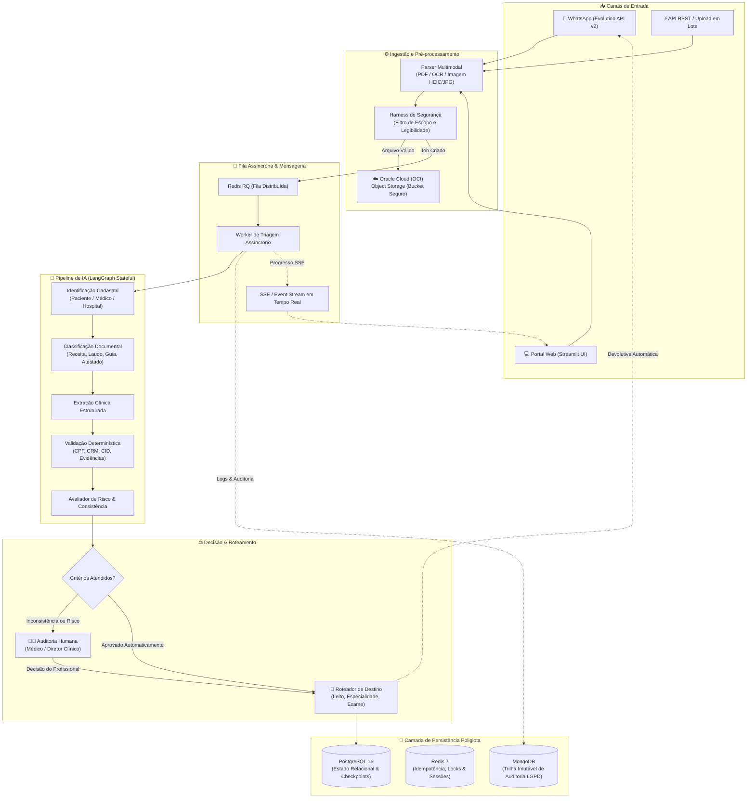

# 🏥 MediFlow — Triagem e Roteamento Inteligente de Documentos Clínicos

<div align="center">


**Plataforma híbrida e resiliente para ingestão multimodal, classificação determinística, extração estruturada de dados clínicos e roteamento hospitalar com validação *Human-in-the-Loop*.**

[Acessar Aplicação em Produção (SSL)](https://129.146.58.37.sslip.io) • [Acesso de Demonstração](#-acesso-para-demonstração) • [Arquitetura](#-arquitetura-do-sistema) • [Execução Local](#-como-executar-localmente)

</div>

---

## 📌 Visão Geral do Projeto

O **MediFlow** foi desenvolvido para solucionar um dos maiores gargalos operacionais do ecossistema de saúde: a ingestão, interpretação e direcionamento de documentos clínicos (pedidos de exame, receitas, guias TISS, atestados e relatórios de alta hospitalar). 

Em vez de confiar cegamente em LLMs generativas, o MediFlow implementa uma **arquitetura híbrida e defensiva**:
1. **Modelos Multimodais (Vision & Language via OpenRouter)** para leitura e extração de dados não estruturados;
2. **Validadores Determinísticos e Regras Rígidas de Negócio** (cálculo de dígito verificador de CPF, validação sintática e cruzamento de CRM/COREN com conselhos regionais, CID-10 e plausibilidade posológica);
3. **Pausa e Retomada Durável com LangGraph Checkpoints**: Qualquer inconsistência, achado crítico ou baixa pontuação de confiança suspende automaticamente o fluxo para revisão humana especializada (*Human-in-the-Loop*).

---

## 🏗 Arquitetura do Sistema



---

## ✨ Principais Diferenciais e Funcionalidades

### 1. Ingestão Multimodal Completa
- Suporte a arquivos **PDF digitais**, **PDFs escaneados**, imagens nos formatos **JPEG, PNG e HEIC** (fotos de celulares iPhone), além de entrada de texto clínico direto via interface ou API.
- Rollback transacional integrado: se o processamento for cancelado antes da fila, o objeto criado no bucket OCI é expurgado automaticamente.

### 2. Pipeline Agêntico Defensivo (LangGraph)
- **Gate de Escopo e Legibilidade:** Rejeita fotos borradas, documentos não médicos e tentativas de injeção de prompt antes do consumo de tokens LLM.
- **Validação de Evidências:** A LLM não pode "alucinar" diagnósticos ou CIDs; cada campo extraído exige citação exata de trecho presente no documento original.
- **Releitura Visual de CPF:** Caso o OCR falhe no dígito verificador do paciente em fotos manuscritas, um laço de releitura visual focada atua antes do envio para auditoria humana.
- **Checkpoint Durável no PostgreSQL:** Sessões de triagem persistidas por `documento_id`; o processo pode ser pausado por horas e retomado pelo médico exatamente de onde parou.

### 3. Integração Autônoma com WhatsApp (Evolution API v2)
- Pacientes podem fotografar receitas e pedidos médicos e enviar diretamente pelo WhatsApp.
- Mapeamento automático de identificadores de dispositivos vinculados (`@lid`) para o número real E.164 do paciente via banco compartilhado.
- Envio instantâneo de protocolo de atendimento e devolutiva com orientações para qual hospital/clínica se dirigir.

### 4. Segurança, LGPD & RBAC
- **4 Níveis Rígidos de Acesso (RBAC):**
  - `ADMIN_GERAL`: Gestão total de usuários, integrações e parâmetros da infraestrutura.
  - `DIRETOR`: Visão gerencial, ecossistema hospitalar e auditoria avançada.
  - `MEDICO`: Auditoria clínica de documentos pendentes, revisão e decisão de encaminhamento.
  - `ENFERMEIRO`: Triagem rápida, acompanhamento de filas e histórico.
- **Mascaramento Automático LGPD:** CPFs e dados pessoais sensíveis são ofuscados automaticamente em logs e saídas de monitoramento estruturadas.
- **Sessão Segura com Cookie HttpOnly/Lax:** Persistência de autenticação imune a perdas de estado por recarregamento (F5) no Streamlit.

---

## 🛠 Tecnologias Utilizadas

| Camada | Tecnologias |
| :--- | :--- |
| **Backend API** | Python 3.11, FastAPI, Pydantic v2, Uvicorn, LangGraph, LangChain, Starlette, HTTPX |
| **Interface Frontend** | Streamlit 1.40+, HTML5 Custom Components, CSS3 Moderno, FontAwesome |
| **Mensageria & Filas** | Redis 7 Alpine, RQ (Redis Queue), Server-Sent Events (SSE) |
| **Bancos de Dados** | PostgreSQL 16 (Relacional + Checkpointer), MongoDB 7 (Auditoria NoSQL), Redis (Cache & Locks) |
| **Nuvem & Armazenamento** | Oracle Cloud Infrastructure (OCI) Object Storage com autenticação por chave RSA (`.pem`) |
| **Comunicação WhatsApp** | Evolution API v2.2.2 (Baileys Engine) rodando em contêiner integrado |
| **Infra & DevOps** | Docker Compose, Nginx Reverse Proxy, Let's Encrypt (Certbot SSL) |

---

## 🔐 Acesso para Demonstração

Para fins de avaliação e demonstração do fluxo de triagem clínica:

| Campo | Valor de Demonstração |
| :--- | :--- |
| **E-mail** | `enfermeiro@mediflow.com.br` |
| **Senha** | `enfermeirodemo` |
| **Perfil** | `ENFERMEIRO` (Ingestão, acompanhamento de filas e histórico) |

---

## 🚀 Como Executar Localmente

### Pré-requisitos
- [Docker](https://docs.docker.com/get-docker/) e [Docker Compose](https://docs.docker.com/compose/) instalados

### 1. Clonar o Repositório
```bash
git clone https://github.com/seu-usuario/mediflow.git
cd mediflow
```

### 2. Configurar Variáveis de Ambiente
Copie o arquivo de exemplo:
```bash
cp .env.example .env
```
> Configure as variáveis no seu `.env` local (chaves de LLM, credenciais de banco e parâmetros de ambiente) conforme documentado no `.env.example`. Nunca versione arquivos `.env` com valores reais.

### 3. Subir a Infraestrutura Completa via Docker Compose
```bash
docker compose --profile infra up -d --build
```

Os seguintes serviços estarão disponíveis:
- **Frontend (Streamlit):** [http://localhost:8501](http://localhost:8501)
- **Backend API (FastAPI + Swagger Docs):** [http://localhost:8000/docs](http://localhost:8000/docs)
- **Painel Evolution API (WhatsApp):** [http://localhost:9085](http://localhost:9085)
- **PostgreSQL:** `localhost:5432`
- **Redis:** `localhost:6379`
- **MongoDB:** `localhost:27017`

---

## 📂 Estrutura do Repositório

```text
.
├── backend/                  # API REST FastAPI e Engine de IA
│   ├── app/
│   │   ├── agent/            # Nós, prompts e grafo de execução LangGraph
│   │   ├── api/              # Roteador central e mapeamento de endpoints
│   │   ├── config/           # Configurações de ambiente, logger e error handlers
│   │   ├── controllers/      # Handlers HTTP, webhooks e controladores SSE
│   │   ├── models/           # Entidades SQLAlchemy (PostgreSQL)
│   │   ├── repositories/     # Camada de persistência (Banco, OCI Storage)
│   │   ├── schemas/          # Schemas Pydantic de validação e serialização
│   │   ├── seeders/          # Carga inicial de hospitais, médicos e usuários
│   │   └── services/         # Regras de negócio, filas RQ e serviços WhatsApp
│   ├── migrations/           # Histórico de migrações do banco (Alembic)
│   └── tests/                # Bateria de testes unitários, integração e resiliência
│
├── frontend/                 # Aplicação Web Streamlit
│   ├── api/                  # Clientes HTTP assíncronos para consumo do backend
│   ├── assets/               # Folhas de estilo CSS personalizadas
│   ├── components/           # Componentes modulares, visualizador de PDFs e cards
│   ├── pages/                # Páginas da aplicação (Triagem, Auditoria, Histórico, WhatsApp)
│   ├── services/             # Gerenciamento de sessão, autenticação e SSE streams
│   └── telas/                # Telas especializadas desacopladas
│
├── DECISIONS/                # Registro formal de decisões de arquitetura (ADRs)
├── DOCUMENTOS/               # Especificações técnicas, diagramas DBML e cronogramas
└── docker-compose.yml        # Orquestração de todos os contêineres e serviços
```

---

## 🧪 Testes Automatizados

Para executar a suíte completa de testes unitários e de integração:

```bash
# Testes do Backend
cd backend
pytest -v

# Testes do Frontend
cd ../frontend
pytest -v
```

---

## 👨‍💻 Equipe do Projeto

Desenvolvido com excelência técnica para o Hackathon:

- **Patrick Gutenberg Gomes Duarte** — *Tech Lead, Arquitetura de Software & Infraestrutura Cloud*
- **Pedro Araujo** — *Coordenação, Setup & Schemas de Dados*
- **Lianna Ribeiro** — *Engenharia de Frontend & Experiência do Usuário*
- **Marcio Jose de Morais** — *Qualidade de Software, Testes & Auditoria*
- **Joao Pedro Alves Botelho** — *Modelagem de Dados & Arquitetura Relacional*
- **Pedro Henrique Marinho Euzebio** — *Engenharia de IA & Grafo de Decisão LangGraph*
- **Otávio Oliveira Santos** — *Ingestão de Dados & Classificação de Documentos*
- **Adilson Gaspar Morais Manuel** — *Integração de Armazenamento OCI & Persistência*

---

<div align="center">
  <sub>MediFlow • Inovação e Segurança em Saúde Digital • 2026</sub>
</div>
